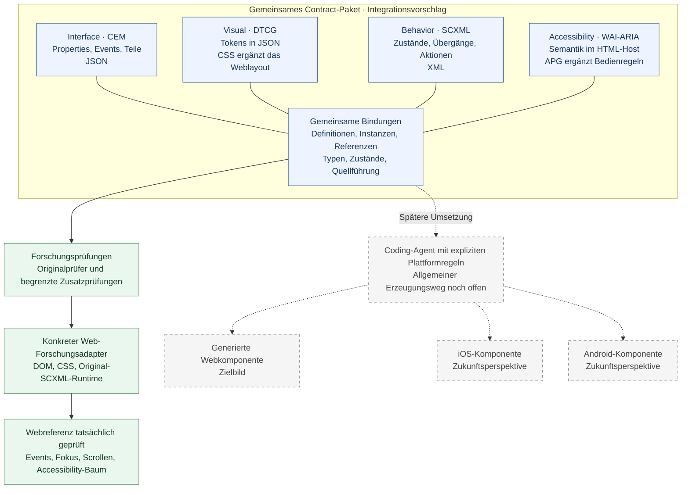

# UI Contracts

**Eine gemeinsame Bauanleitung für UI-Komponenten — für Menschen und Coding-Agenten.**

UI Contracts untersucht, wie sich Schnittstelle, Gestaltung, Verhalten und Accessibility eindeutig beschreiben und zu einem gemeinsamen Contract-Paket verbinden lassen. Bestehende Standards behalten ihre Fachmodelle; gemeinsame Bindungen machen ihre Beziehungen prüfbar.

**Recherche abgeschlossen** · **Webreferenz geprüft** · **Produktumsetzung offen**

[Das Prinzip](#das-prinzip) · [Architektur](#architektur) · [Nachweise](#nachweise) · [Dokumentation](#dokumentation) · [Weiterarbeit](#weiterarbeit)

## Das Prinzip

Ein Agent soll Properties, Layout, Zustände und Bedienregeln aus einer präzisen Beschreibung ableiten können. Dieselbe Information hat genau eine führende Quelle. So werden Entscheidungen nachvollziehbar, Widersprüche erkennbar und Komponenten wiederverwendbar.

Der konkrete **Integrationsvorschlag IP-01** verbindet vier getrennte Domänen:

| Domäne | Führende Informationen | Beitrag im Webvorschlag |
| --- | --- | --- |
| **Interface** | Properties, Typen, Events, Payloads und benannte Teile | **CEM** · JSON |
| **Visual** | Tokens, Dimensionen, Varianten und Layoutregeln | **DTCG** · JSON; **CSS** ergänzt das Weblayout |
| **Behavior** | Zustände, Übergänge, Guards, Aktionen und Interaktion | **SCXML** · XML |
| **Accessibility** | Semantik, Namen, Beziehungen und zugängliche Rückmeldungen | **WAI-ARIA** im HTML-Host; **APG** ergänzt Bedienmuster |

Die Formate müssen dafür nicht vereinheitlicht werden. Eine zusätzliche Bindung verbindet Definitionen, konkrete Instanzen, Teile und Zustände. Originalprüfer und begrenzte Zusatzprüfungen haben jeweils eine klar benannte Aufgabe. Vier logische Domänen können mehrere Dateien umfassen; die produktive Bindungssyntax ist noch nicht festgelegt.

**Das spätere Ziel:** Aus derselben fachlichen Bauanleitung sollen Agenten Web-, iOS- und Android-Komponenten mit den vereinbarten visuellen und funktionalen Eigenschaften erstellen können. Native Plattformen sind Zukunftsperspektive. Ihre Abbildungen sind noch nicht nachgewiesen und gehören nicht zur abgeschlossenen Recherchephase.

## Architektur

**Blau:** Integrationsvorschlag. **Grün:** im begrenzten Forschungsfall ausgeführt. **Gestrichelt:** späterer Erzeugungsweg. Der geprüfte Webadapter ist noch kein allgemeiner Generator oder deklarativer Runtime-Resolver.

[Integrationsprofil und Zuständigkeiten](docs/research/INTEGRATION-PROFILE.md) · [Konkreter Bindungsentwurf](docs/research/INTEGRATION-BINDING-DRAFT.md)

## Nachweise

Ein Autocomplete dient als Referenzfall: zwei unabhängige Verwendungen, jeweils mit eigenem Overlay und eigener ScrollArea. Schnittstelle, Werte, Verhalten und zugängliche Beziehungen werden dabei gemeinsam betrachtet. Abstand und sichtbare Zeilenzahl sind Beispielwerte, keine allgemeinen Produktpflichten.

Im gemeinsamen Browserlauf sind **20 von 20 finalen Prüferwartungen erfüllt**:

- Öffentliche Events und Payloads, Auswahl und unabhängige Instanzen.
- Tatsächlicher Inputfokus, Navigation und Scrollsichtbarkeit.
- Lade-, Leer- und Fehlerzustände sowie aktuelle und verspätete Antworten.
- Child-Lifecycle, Abbruch und Wiederöffnung.
- Tatsächliche Accessibility-Bäume, Beziehungen und Statusrückmeldungen.

Der Nachweis gilt für den dokumentierten Webreferenzfall mit ausdrücklich ausgewiesenen eigenen Adaptern. Echte Screenreader- und IME-Abnahme sowie eine allgemeine Produkt- oder Plattformfreigabe folgen daraus nicht.

[Browser-Abschlussbericht](docs/research/experiments/2026-10-25/ip01-browser/REPORT.md) · [Statisches Referenzpaket](docs/research/experiments/2026-10-25/ip01-static/REPORT.md)

<strong>Forschungsumfang und verbleibende Originalfragen</strong>

Stand: **25. Oktober 2026**. Projektstart: 23. Oktober 2026.

| Umfang | Dokumentierter Stand |
| --- | ---: |
| Untersuchte Kandidaten | 16 |
| Bewertungen in der Matrix | 416 |
| Begründete Befunde | 543 |
| Quellenkennungen | S01–S129 |
| Ausgeführte Prüfgruppen | 106 |
| Unterschiedliche Prüfbedingungen | 702 |
| Externe Originalklärungen | 2 |

Die 702 Bedingungen sind kein Erfolgszähler. Historische Verletzungen, unerwartete Ergebnisse und eigene Korrekturen bleiben erhalten; Wiederholungen werden nicht erneut gezählt. Originalfähigkeiten, zusätzliche Adapter und Vorschläge sind getrennt gekennzeichnet.

Offen bleiben zwei konkret dokumentierte Herausgeberfragen zu **Google DESIGN.md X06** und **OpenUI X06**. Sie betreffen die geprüften Originalstände, sind keine Voraussetzungen der ausgewählten Webreferenz und blockieren den Rechercheabschluss nicht. Es wurden keine Autorenanfragen versandt.

[Aktueller Nachweisstand](docs/research/CURRENT-STATUS.md) · [Die zwei Originalklärungen](docs/research/OPEN-QUESTIONS.md) · [Methodik](docs/research/METHODS.md)

## Dokumentation

Die vollständige Recherche liegt in **[`docs/research/`](docs/research/)**. Aktuelle Ergebnisse, Rohdaten und historische Zwischenstände sind dort erschlossen.

| Du möchtest … | Einstieg |
| --- | --- |
| Das Ergebnis und die Lesereihenfolge verstehen | [Rechercheabschluss](docs/research/RESEARCH-CLOSEOUT.md) |
| Den gemeinsamen Vorschlag im Detail lesen | [Integrationsprofil IP-01](docs/research/INTEGRATION-PROFILE.md) |
| Anforderungen und Kandidaten vergleichen | [Anforderungen](docs/research/REQUIREMENTS.md) · [Matrix](docs/research/MATRIX.md) |
| Aussagen und Originalquellen nachvollziehen | [Befunde](docs/research/CLAIMS.md) · [Quellenregister](docs/research/SOURCES.md) |
| Berichte, Versuche und Rohresultate finden | [Dokumentenindex](docs/research/DOCUMENT-INDEX.md) · [Experimentindex](docs/research/experiments/INDEX.md) |
| Mit einem Coding-Agenten weiterarbeiten | [Umsetzungsübergabe](docs/research/IMPLEMENTATION-HANDOFF.md) · [Aufgaben](TASKS.md) |
| Frühere Entscheidungen und Zwischenstände lesen | [Originalkontext](docs/research/CONTEXT.md) · [Vollständiges README-Archiv](docs/research/archive/README-RESEARCH-ARCHIVE.md) |

## Weiterarbeit

**Erster Bibliothekseintrag:** Die [Definitionsbibliothek](components/README.md) beginnt mit [Autocomplete](components/autocomplete/README.md), Overlay und ScrollArea. Ein [eigenständiger Design-Proof](examples/autocomplete/README.md) hat einen neuen Agenten ohne übernommenen Gesprächsverlauf daraus ein editierbares OpenPencil-Dokument erstellen lassen. Die Originaldatei wurde unabhängig geprüft; aufgedeckte Definitionslücken bleiben dokumentiert. Die Definitionen führen; Zielartefakte werden daraus erzeugt.

Die Forschungsgrundlage, konkrete Referenzdateien und ein ausgeführter Webforschungs-Host liegen vor. Eine produktive Komponentenbibliothek ist noch nicht umgesetzt. Vor der Produktumsetzung sind insbesondere Bindungssyntax, allgemeiner Resolver und der verbindliche fachliche Umfang festzulegen.

Später können spezialisierte Skills die vier Domänen bearbeiten. Sie sollen Quellführung und Konfliktregeln respektieren; Stabilität und Reifegrad der gewählten Beiträge bleiben Auswahlkriterien. Solche Skills sind hier noch nicht erstellt.

Die Recherche ist abgeschlossen. Für eine spätere Fortsetzung stehen der [Abnahmeplan](docs/research/INTEGRATION-ACCEPTANCE.md), die [Umsetzungsübergabe](docs/research/IMPLEMENTATION-HANDOFF.md) und die [Einordnung des plattformübergreifenden Ziels](docs/research/ARCHITECTURE-DIRECTION.md) bereit.

[Studie AC-R01](docs/research/studies/AC-R01/README.md): Zwei getrennte Agenten erzeugen aus derselben Autocomplete-Definition Designs mit gleichen gemessenen Komponentenwerten, aber demselben Farbfehler. Vollständige Definitionstreue ist in diesem Versuch nicht erreicht.
