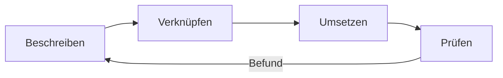

# UI Contracts

**Eine prüfbare Bauanleitung für UI-Komponenten — für Menschen und Coding-Agenten.**

UI Contracts beschreibt Schnittstelle, Gestaltung, Verhalten und Accessibility in verknüpften Originaldateien. Daraus können Agenten Designs und Implementierungen ableiten und gezielt prüfen.

**Stand:** Forschungsframework mit konkreten Definitionen, editierbaren Design-Proofs und begrenzten Webprüfern. Allgemeine Generierung, Produktionsfreigabe und iOS-/Android-Adapter bleiben offen.

## Direkt einsteigen

| Vorhaben | Nächster Schritt |
| --- | --- |
| Mit einem Agenten arbeiten | [Kurze Handlungsregeln](skills/ui-contracts/SKILL.md) |
| Eigene Komponentenbibliothek aufbauen | [Bibliothek anlegen und ausdrücklich auswählen](libraries/README.md) |
| Eine passende Komponente auswählen | [UX-Regeln und Policy](tools/ux/README.md) |
| Ergebnis zusammenführen und prüfen | [Gesamtabgleich](skills/ui-contracts/references/integration-review.md) · [Unterstützte Webprüfung](tools/web/README.md) |
| Orientierung oder Details suchen | [Dokumentationswege](docs/README.md) · [Aktueller Stand](docs/STATUS.md) |

```sh
python3 tools/libraries/manage.py init meine-app --name "Meine App"
```

Die neue Bibliothek beginnt leer unter `libraries/meine-app/`: `components/` für Definitionen, `assets/` für gemeinsame Dateien. `example` bleibt eine gezielt nachladbare Forschungsbibliothek.

## Das Prinzip



| Domäne | Führende Grundlage |
| --- | --- |
| Technisches Interface | **CEM**: Properties, Typen und Events |
| Visuelles Design | **DTCG/CSS**: Tokens und Layoutregeln |
| UX-Verhalten | **SCXML**: Zustände, Aktionen und Übergänge |
| Accessibility | **HTML/ARIA**, ergänzt durch APG-Bedienmuster |

`component.json` verbindet Quellen, Teile und Unterkomponenten. UX-Eignungsregeln ergänzen, wann ein Control fachlich passt. Jede Information behält ihre führende Quelle. [Architektur und Zusammenspiel](docs/ARCHITECTURE.md).

## Wissen nach Bedarf

Die wichtigste Handlung steht im Skill. Detailanleitungen, konkrete Definitionen und Forschungsbelege werden für den jeweiligen Arbeitsschritt nachgeladen. Kleine Teilaufträge halten Ergebnisse mit Quellenverweisen fest; am Ende prüft ein Gesamtabgleich die betroffenen Regeln und Verbindungen. So bleibt das Wissen erreichbar, ohne den gesamten Bestand in jeden Kontext zu laden.

[Mehrstufiger Ablauf](skills/ui-contracts/references/workflow.md) · [Informationsstruktur](docs/README.md#lesen-nach-der-umgekehrten-pyramide). Modellvergleiche dienen optional der Forschung; sie sind kein hartes Einsatzkriterium.

## Was bisher nachgewiesen ist

- **Originalquellen und UX:** aktive Beispielbibliothek mit begrenzten Quellen-/SCXML- und nativen Policyprüfungen. [Operativer Einstieg](tools/ux/README.md).
- **Web:** aktuelle quellengebundene Fälle prüfen tatsächliche Events, Fokus, Scrollen und Browsersemantik für vier Profile. [Nachweise und Grenzen](docs/research/analyses/WEB-RUNTIME-2026-10-31/README.md).
- **Design:** editierbare OpenPencil-Ausgaben und unabhängige Reproduktionsstudien zeigen Ergebnisse sowie erhaltene Fehler. [Autocomplete-Proof](examples/autocomplete/README.md) · [Studien](docs/research/STUDIES.md).

Ein begrenzter Nachweis ist keine allgemeine Konformitätsfreigabe. Der [aktuelle Stand](docs/STATUS.md) unterscheidet verfügbare Werkzeuge und offene Punkte.

[Entwicklungsschritte](docs/EVOLUTION.md) · [Aufgaben](TASKS.md) · [Forschungsherkunft](docs/research/README.md)
