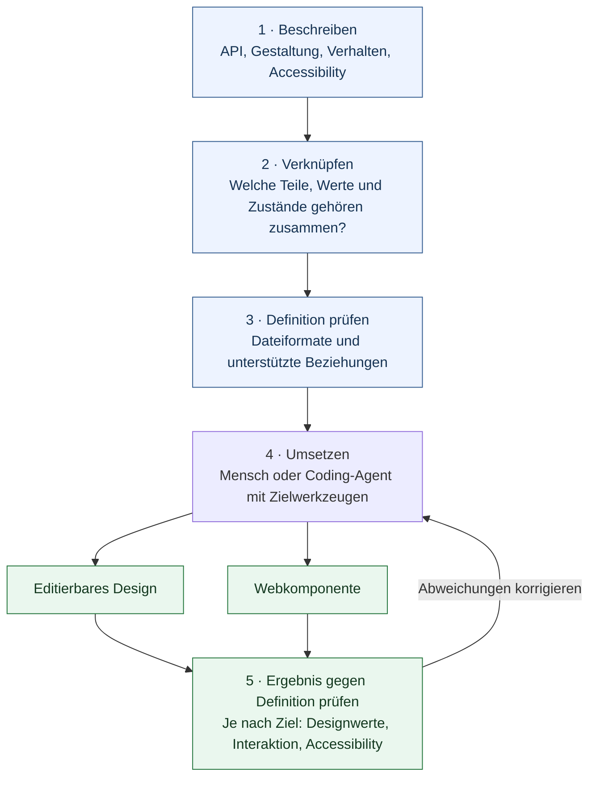
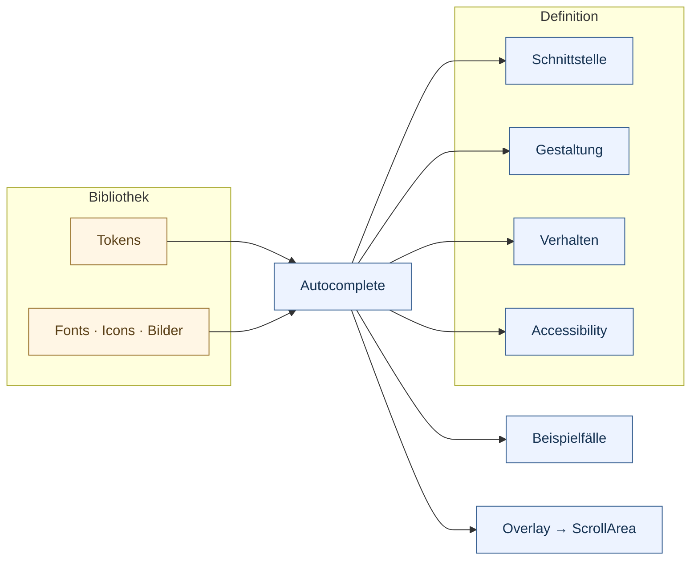

# UI Contracts

**Eine prüfbare Bauanleitung für UI-Komponenten — für Menschen und Coding-Agenten.**

UI Contracts beschreibt, **was eine Komponente kann, wie sie aussieht und wie sie sich bedienen lässt**. Verknüpfte Dateien bilden die gemeinsame Grundlage für Design, Implementierung und gezielte Prüfungen.

**Ziel:** Aus derselben Beschreibung Designs und Komponenten für Web, iOS und Android erstellen.

**Stand:** Forschungsprojekt mit konkreten Definitionen, Design-Proofs und geprüfter Webreferenz. Produktbibliothek, allgemeiner Generator und native Plattformadapter sind noch offen.

[Ablauf](#wie-es-funktioniert) · [Komponentenaufbau](#was-in-einer-komponente-steckt) · [Starten](#eigene-bibliothek-starten) · [Nachweise](#was-bisher-geprüft-ist) · [Dokumentation](#weiterlesen)

## Wie es funktioniert



**Beispiel:** SCXML beschreibt, wann ein Popup offen ist. Verknüpfungsregeln ordnen diesen Zustand der sichtbaren Popupfläche und `aria-expanded` am Eingabefeld zu. Der Webadapter setzt diese Zuordnung um. Die Prüfung kontrolliert die erwartete Wirkung.

Der Ablauf wurde in begrenzten Referenzfällen erprobt. Originalprüfer prüfen ihre Formate; Zusatzprüfungen kontrollieren unterstützte Verknüpfungen. Ein Designexport weist keine funktionierende Interaktion nach.

## Was in einer Komponente steckt

Am Beispiel **Autocomplete** aus der Forschungsbibliothek `example`:



`component.json` verknüpft die Quellen und Unterkomponenten. Tokens und Assets werden gemeinsam genutzt; `stories.json` liefert Beispielfälle. **Jede Information hat eine führende Quelle.** Die Originalstandards bleiben erhalten; Verknüpfungsregeln ergänzen ihre Beziehungen.

| Frage | Führende Beschreibung |
| --- | --- |
| Was kann ich setzen und empfangen? | **CEM**: Properties, Typen, Events |
| Wie sieht die Komponente aus? | **DTCG/CSS**: Tokens und Layoutregeln |
| Was passiert bei Eingabe oder Zustandswechsel? | **SCXML**: Verhalten |
| Wie wird sie zugänglich bedienbar? | **HTML/ARIA**, ergänzt durch APG-Bedienmuster |

Zusätzlich wird erforscht, **wann eine Komponente zur Aufgabe passt**: `ux.json` beschreibt Fähigkeiten; Auswahlregeln vergleichen Kandidaten. Diese [UX-Forschung](docs/research/studies/UX-RULES-01/README.md) ergänzt die vier Domänen und ist noch keine festgelegte Formatentscheidung. Die [UX-Leitlinie für Autocomplete](docs/ux/AUTOCOMPLETE.md) trennt freie Schreibhilfe von verbindlicher Auswahl.

[Autocomplete-Definition](libraries/example/components/autocomplete/README.md) · [Verknüpfungsregeln im Detail](docs/research/INTEGRATION-BINDING-DRAFT.md)

## Eigene Bibliothek starten

```sh
python3 tools/libraries/manage.py init meine-app --name "Meine App"
```

Legt eine leere Bibliothek unter `libraries/meine-app/` an. Komponenten kommen nach `components/`, gemeinsame Ressourcen nach `assets/`; `library.json` und `tokens.json` liegen am Bibliotheksroot. Ein Agentenauftrag benennt die Bibliothek und das gewünschte Ziel ausdrücklich. Inhalte aus `example` werden nicht automatisch übernommen.

[Bibliotheksaufbau und Auswahl](libraries/README.md) · [Lokale Fonts](docs/fonts/README.md) · [Contract-Skill und Prüfumfang](docs/skills/README.md)

## Was bisher geprüft ist

- **Webreferenz:** 20 von 20 finalen Prüferwartungen im dokumentierten Autocomplete-Browserlauf mit eigenem Adapter erfüllt: zwei unabhängige Instanzen mit Overlay und ScrollArea, Events, Fokus, Navigation, Scrollsichtbarkeit, Lade-/Fehlerzustände, verspätete Antworten, Lifecycle und zugängliche Beziehungen. [Browserbericht](docs/research/experiments/2026-10-25/ip01-browser/REPORT.md) · [Statisches Referenzpaket](docs/research/experiments/2026-10-25/ip01-static/REPORT.md)
- **Design-Proofs:** Editierbare OpenPencil-Ausgaben erstellt und unabhängig geprüft. Dabei wurden auch Definitionslücken und Reproduktionsfehler sichtbar. [Autocomplete-Proof](examples/autocomplete/README.md) · [Reproduktionsstudien](docs/research/STUDIES.md)
- **Offen:** Produktformat der Verknüpfungsregeln, allgemeiner Resolver und Generator, iOS-/Android-Abbildungen sowie echte Screenreader- und IME-Abnahme. Die Referenzprüfungen sind keine allgemeine Produktfreigabe.

## Weiterentwicklung

**Nächster beschlossener Schritt:** [RD-001](docs/research/decisions/RD-001-STAGED-GENERATION.md) sieht einen Vergleich von direkter und gestufter Erzeugung vor. Der [Stufenpilot](docs/research/protocols/STAGED-GENERATION-PILOT.md) ist geplant, noch nicht gestartet; er ist von den Auswahlstudien getrennt.

<details>
<summary>Forschungsschritte und laufende Studien</summary>

Seit **Oktober 2026** wächst UI Contracts von der Standardsuche zu einem erprobbaren Arbeitsablauf. Die Schritte bauen aufeinander auf; jeder Nachweis hat seinen eigenen begrenzten Umfang.

1. **Vier Domänen verbinden.** Die Recherche verglich 16 Kandidaten für Schnittstelle, Gestaltung, Verhalten und Accessibility. Daraus entstand [IP-01](docs/research/INTEGRATION-PROFILE.md): CEM, DTCG/CSS, SCXML und HTML/ARIA bleiben führend und werden über ausdrückliche Verknüpfungsregeln verbunden. Die Kandidatenrecherche wurde am 25. Oktober abgeschlossen.
2. **Eine konkrete Komponente durchspielen.** [Autocomplete mit Overlay und ScrollArea](libraries/example/components/autocomplete/README.md) machte das Modell greifbar. Ein [Webreferenzlauf](docs/research/experiments/2026-10-25/ip01-browser/REPORT.md) prüfte Verhalten und zugängliche Beziehungen; ein separater [Design-Proof](examples/autocomplete/README.md) führte zur editierbaren OpenPencil-Datei und deckte Definitionslücken auf.
3. **Unabhängig reproduzieren und Aufgaben fokussieren.** Weitere [Reproduktionsläufe](docs/research/STUDIES.md) trennten Übereinstimmung von Definitionstreue: ähnliche Designs konnten denselben Fehler enthalten. Daraus entstanden Reparaturen an Prüfhilfen sowie [fokussierte Rollen und quellengebundene Übergaben](skills/ui-contracts/references/workflow.md). Ihr allgemeiner Nutzen für zuverlässigere Erzeugung ist noch nicht belegt.
4. **Bibliotheken und Ressourcen trennen.** Seit dem 29. Oktober können Projekte eigene [Bibliotheken](libraries/README.md) ausdrücklich auswählen. Komponenten und gemeinsame Assets sind getrennt; [lokale Fonts](docs/fonts/README.md) machen die Schriftgrundlage prüfbar. `example` bleibt Forschungsreferenz.
5. **Ergebnisse sichtbar und messbar machen.** Eine [native OpenPencil-Präsentation](docs/skills/OPENPENCIL-PREVIEW.md) vereinheitlicht Vorschauen; explizite Theme-Zuordnungen ergänzen helle und dunkle Karten. Die [Geometriehilfe](skills/ui-contracts/references/geometry.md) unterstützt berechnete Formen, erprobt am [editierbaren Pie-Chart-Proof](examples/charts/pie-chart/README.md). Das sind begrenzte Werkzeugnachweise, keine allgemeine Designabnahme.
6. **Von Eigenschaften zur begründeten Auswahl.** Seit dem 30. Oktober untersucht [UX-RULES-01](docs/research/studies/UX-RULES-01/README.md) formale Regeln für Eignung und Einsatzbedingungen. Ein [Autocomplete-Pilot](docs/research/studies/UX-RULES-01/pilots/AC-UX-01/README.md) erprobt DMN mit Regeltrace. Die neue [Studie SELECTION-01](docs/research/studies/UX-RULES-01/studies/SELECTION-01/README.md) ergänzt Select und Input und untersucht die Komponentenwahl für ein Personenformular mit drei bzw. 30 Ländervorwahlen. **Beide Builder folgen der damaligen Auswahlpolicy; zwei Implementierungsfehler wurden separat repariert.** Der [Folgelauf mit Select mit Suche](docs/research/studies/UX-RULES-01/studies/SELECTION-02/README.md) bestätigt die neue Auswahlpolicy mit vollständigerem Angebot; ein Fokusfehler wurde separat repariert. Die Suchgrenze von 15 Optionen ist Studienpolicy, kein allgemeines UX-Gesetz.

Zwei [Originalklärungen zu Google DESIGN.md und OpenUI](docs/research/OPEN-QUESTIONS.md) bleiben offen; sie blockieren weder den Rechercheabschluss noch die ausgewählte Webreferenz. Forschungszahlen und Grenzen stehen im [Nachweisstand](docs/research/CURRENT-STATUS.md), die Zählregeln in der [Methodik](docs/research/METHODS.md).

</details>

## Weiterlesen

| Thema | Einstieg |
| --- | --- |
| Architektur und Zuständigkeiten | [Integrationsprofil IP-01](docs/research/INTEGRATION-PROFILE.md) |
| Standardsuche und Forschungsstand | [Rechercheabschluss](docs/research/RESEARCH-CLOSEOUT.md) · [Aktueller Nachweisstand](docs/research/CURRENT-STATUS.md) |
| Anforderungen und Originalquellen | [Matrix](docs/research/MATRIX.md) · [Befunde](docs/research/CLAIMS.md) · [Quellenregister](docs/research/SOURCES.md) |
| Definitionen und Ergebnisse prüfen | [Prüfkette und Grenzen](docs/validation/README.md) |
| Mit Agenten arbeiten | [Rollen und Übergaben](skills/ui-contracts/references/workflow.md) · [Fehlerregister](docs/skills/ISSUES.md) |
| Nächste Umsetzungsschritte | [Aufgaben](TASKS.md) · [Umsetzungsübergabe](docs/research/IMPLEMENTATION-HANDOFF.md) · [Abnahmeplan](docs/research/INTEGRATION-ACCEPTANCE.md) |
| Quellen und historische Ergebnisse | [Dokumentenindex](docs/research/DOCUMENT-INDEX.md) · [README-Archiv](docs/research/archive/README-RESEARCH-ARCHIVE.md) |
