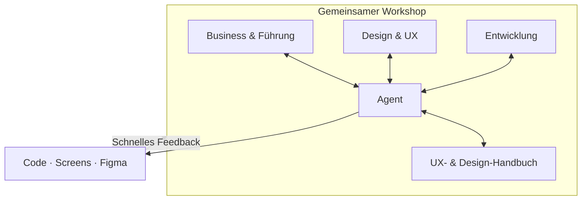

# UI Contracts

**Ein digitales, formalisiertes UX- und Design-Handbuch für Business, Führung, Design und Entwicklung.**

UI Contracts hält gemeinsam vereinbarte Vorgaben fest: Wie sehen Komponenten aus, wie funktionieren sie und wann passen sie zu einer fachlichen Aufgabe? „Formalisiert“ bedeutet: Die Regeln sind so präzise und strukturiert beschrieben, dass Agenten damit arbeiten und Werkzeuge Teile davon prüfen können.

## Gemeinsam spezifizieren, schnell Feedback bekommen



Alle Beteiligten legen gemeinsam fest, was die Oberfläche leisten und wie sie funktionieren soll. Der Agent ist Teil des Workshops: Er macht Entscheidungen schnell als Code, Screens oder bearbeitbares Design sichtbar. Das Team prüft diese Ergebnisse gemeinsam und präzisiert die Vorgaben. So können Missverständnisse bereits in der Konzeptionsphase auffallen und geklärt werden.

**Zum Beispiel:** Ein Formular soll eine Telefonnummer erfassen. Bei drei festen Ländervorwahlen kann ein Select genügen; bei einer langen Liste kommt ein Select mit Suche infrage. Das Handbuch beschreibt die Eignung, Gestaltung und Bedienung der Komponenten. Der Agent nutzt diese Vorgaben für einen Entwurf, zu dem das Team direkt Feedback gibt.

Code, Screenshots, Mockups und Figma-Dateien sind mögliche **Ergebnisse** der Vorgaben. Eine Figma-Datei kann auch wieder **Eingabe** sein: Änderungen werden mit den bestehenden Regeln abgeglichen und bewusst ins Handbuch übernommen. So bleibt nachvollziehbar, welche Vorgaben gelten. Ein Screenshot zeigt eine Darstellung, enthält aber allein keinen vollständigen Verhaltensvertrag.

**Stand:** Forschungsframework mit konkreten Definitionen, editierbaren Design-Proofs und begrenzten Webprüfern. Der gemeinsame Workshop beschreibt den angestrebten Arbeitsprozess; eine Beschleunigung der Zusammenarbeit ist noch nicht empirisch nachgewiesen. Allgemeine Generierung, Produktionsfreigabe und iOS-/Android-Adapter bleiben offen.

## Direkt einsteigen

| Vorhaben | Nächster Schritt |
| --- | --- |
| Mit einem Agenten arbeiten | [Kurze Handlungsregeln](skills/ui-contracts/SKILL.md) |
| Eigene Komponentenbibliothek aufbauen | [Bibliothek anlegen und ausdrücklich auswählen](libraries/README.md) |
| Eine passende Komponente auswählen | [UX-Regeln und Policy](tools/ux/README.md) |
| Ergebnis zusammenführen und prüfen | [Gesamtabgleich](skills/ui-contracts/references/integration-review.md) · [Unterstützte Webprüfung](tools/web/README.md) |
| Orientierung oder Details suchen | [Dokumentationswege](docs/README.md) · [Aktueller Stand](docs/STATUS.md) |

```sh
python3 tools/libraries/manage.py init meine-app --name "Meine App"
```

Die neue Bibliothek beginnt leer unter `libraries/meine-app/`: `components/` für Definitionen, `assets/` für gemeinsame Dateien. `example` bleibt eine gezielt nachladbare Forschungsbibliothek.

## Das Prinzip

Die Vorgaben sind in vier verknüpften Bereichen beschrieben. Jeder Bereich hat eine führende Grundlage:

| Domäne | Führende Grundlage |
| --- | --- |
| Technisches Interface | **CEM**: Properties, Typen und Events |
| Visuelles Design | **DTCG/CSS**: Tokens und Layoutregeln |
| UX-Verhalten | **SCXML**: Zustände, Aktionen und Übergänge |
| Accessibility | **HTML/ARIA**, ergänzt durch APG-Bedienmuster |

`component.json` verbindet Quellen, Teile und Unterkomponenten. UX-Eignungsregeln ergänzen, wann ein Control fachlich passt. Jede Information behält ihre führende Quelle. [Architektur und Zusammenspiel](docs/ARCHITECTURE.md).

## Wissen nach Bedarf

Die wichtigste Handlung steht im Skill. Detailanleitungen, konkrete Definitionen und Forschungsbelege werden für den jeweiligen Arbeitsschritt nachgeladen. Kleine Teilaufträge halten Ergebnisse mit Quellenverweisen fest; am Ende prüft ein Gesamtabgleich die betroffenen Regeln und Verbindungen. So bleibt das Wissen erreichbar, ohne den gesamten Bestand in jeden Kontext zu laden.

[Mehrstufiger Ablauf](skills/ui-contracts/references/workflow.md) · [Informationsstruktur](docs/README.md#lesen-nach-der-umgekehrten-pyramide). Modellvergleiche dienen optional der Forschung; sie sind kein hartes Einsatzkriterium.

## Was bisher nachgewiesen ist

- **Originalquellen und UX:** aktive Beispielbibliothek mit begrenzten Quellen-/SCXML- und nativen Policyprüfungen. [Operativer Einstieg](tools/ux/README.md).
- **Web:** aktuelle quellengebundene Fälle prüfen tatsächliche Events, Fokus, Scrollen und Browsersemantik für vier Profile. [Nachweise und Grenzen](docs/research/analyses/WEB-RUNTIME-2026-10-31/README.md).
- **Design:** editierbare OpenPencil-Ausgaben und unabhängige Reproduktionsstudien zeigen Ergebnisse sowie erhaltene Fehler. [Autocomplete-Proof](examples/autocomplete/README.md) · [Studien](docs/research/STUDIES.md).

Ein begrenzter Nachweis ist keine allgemeine Konformitätsfreigabe. Der [aktuelle Stand](docs/STATUS.md) unterscheidet verfügbare Werkzeuge und offene Punkte.

[Entwicklungsschritte](docs/EVOLUTION.md) · [Aufgaben](TASKS.md) · [Forschungsherkunft](docs/research/README.md)
