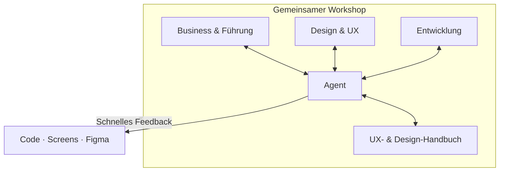
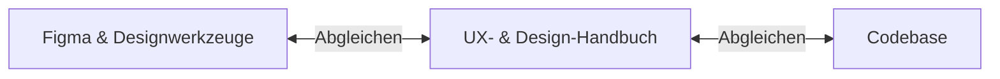
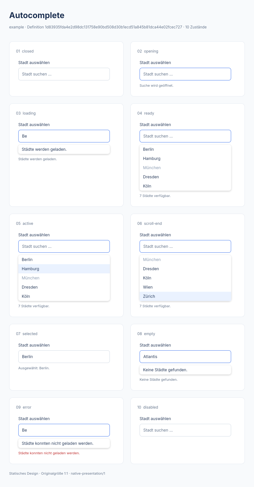
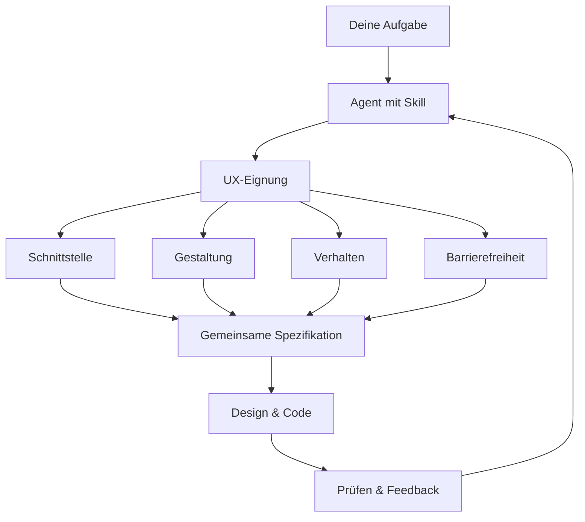

# UI Contracts

**Ein digitales, formalisiertes UX- und Design-Handbuch für Business, Führung, Design und Entwicklung.**

UI Contracts hält gemeinsam vereinbarte Vorgaben fest: Wie sehen Komponenten aus, wie funktionieren sie und wann passen sie zu einer fachlichen Aufgabe? „Formalisiert“ bedeutet: Die Regeln sind so präzise und strukturiert beschrieben, dass Agenten damit arbeiten und Werkzeuge Teile davon prüfen können.

## Gemeinsam spezifizieren, schnell Feedback bekommen



**Gemeinsam festlegen, sofort sehen, früh klären.** Business, Führung, Design und Entwicklung spezifizieren mit dem Agenten die gewünschte UI. Er erzeugt Code, Screens oder Figma-Designs für direktes Feedback. Entscheidungen fließen ins Handbuch zurück; Missverständnisse werden früh sichtbar.

Der Ablauf unterstützt eine **Lean-UX-Arbeitsweise**: gemeinsam entwerfen, früh ausprobieren und aus Feedback lernen. UI Contracts hält die vereinbarten Regeln nachvollziehbar fest. Ob eine Lösung den Nutzern tatsächlich hilft, muss zusätzlich mit ihnen geprüft werden. [Einordnung zu Hypothesen und Experimenten von Jeff Gothelf](https://jeffgothelf.com/blog/process-experiments/).

> **Beispiel: Telefonnummer erfassen**
>
> Drei feste Ländervorwahlen: ein Select. Lange Liste: ein Select mit Suche. Der Agent erstellt den Entwurf nach den Komponentenregeln; das Team prüft und präzisiert ihn gemeinsam.

## Verbindet Design und Entwicklung

**UI Contracts ergänzt Figma, andere Designwerkzeuge und eure Codebase – es löst sie nicht ab.** Das Handbuch hält die gemeinsam vereinbarten Regeln fest und verbindet sie mit den Designs und Implementierungen.



Der Austausch geht in beide Richtungen: Vorgaben können in Designs und Code umgesetzt werden. Umgekehrt können bestehende Designs oder eine Codebase als Ausgangspunkt dienen, um Regeln zu erschließen und Änderungen ins Handbuch zurückzuführen. Der Agent unterstützt diesen Abgleich; das Team entscheidet über offene Fragen und Änderungen an den gemeinsamen Vorgaben. [Rückweg-Anleitungen](skills/ui-contracts/references/reverse.md) · [Draftlücken sichtbar machen](tools/completeness/README.md).

## So sieht ein Ergebnis aus

Aus einer eingefrorenen Autocomplete-Definition entstand dieses editierbare OpenPencil-Design mit zehn Zuständen. Die Vorschau ist ein gerendertes Ergebnis, kein interaktives Control.

<a href="examples/autocomplete/output/openpencil/run-04/builder-a/preview.png"></a>

[Definition und erster Proof](examples/autocomplete/README.md) · [Herkunft dieser Vorschau](examples/autocomplete/output/openpencil/run-04/README.md).

## Mit dem Skill einsteigen

**Beschreibe die Aufgabe; der Skill führt den Agenten durch die Arbeit.** Formate, Detailregeln und Werkzeuge lädt er passend zum jeweiligen Schritt nach.

1. **Skill bereitstellen:** Den [UI-Contracts-Skill](skills/ui-contracts/SKILL.md) für deinen Agenten einrichten oder als Projekteinstieg angeben. [Skill und Arbeitswege](docs/skills/README.md).
2. **Bibliothek wählen:** Eigene Vorgaben nutzen oder [eine leere Bibliothek anlegen](libraries/README.md). `example` dient ausdrücklich als Orientierung oder gewählte Beispieleingabe.
3. **Aufgabe beschreiben:** Bibliothek, Anforderung und Ziel nennen, etwa: „Nutze die Bibliothek example. Wähle passende Komponenten für ein Telefonnummernformular und erstelle zunächst einen Designentwurf. Halte offene Regeln fest.“


Ausführbare Anwendungen für lokales Browserfeedback entstehen in der [Anwendungswerkstatt](apps/README.md).



**Zuerst die passende Komponente, dann ihre Ausgestaltung:** UX-Regeln helfen bei der Auswahl. Die vier Domänen beschreiben Schnittstelle, Aussehen, Reaktion und Zugänglichkeit. Aktuell bündelt ein Skill diese Arbeitsbereiche mit gezielt nachladbaren Anleitungen.

## Wie ist es aufgebaut und wie funktioniert es?

Das Handbuch liegt als versionierte Dateien im Repository. Jede Bibliothek hat eigene Komponenten, gemeinsame Design-Tokens und Assets. Eine Komponente besteht aus mehreren verknüpften Quellen; die vier Domänen bleiben getrennt:

| Domäne | Grundlage | Typische Datei | Beschreibt zum Beispiel |
| --- | --- | --- | --- |
| Technisches Interface | **CEM** (Custom Elements Manifest) | `interface.json` | Properties, Typen und Events |
| Visuelles Design | **DTCG/CSS** | `tokens.json`, `layout.css` | Farben, Abstände, Schrift und Layout |
| UX-Verhalten | **SCXML** | `behavior.scxml` | Zustände, Aktionen und Übergänge |
| Accessibility | **HTML/ARIA**, ergänzt durch **APG** | `accessibility.html` | Semantik, zugängliche Namen und Beziehungen |

`component.json` ist der Einstieg zur Komponente: Es verweist auf diese Quellen und verbindet Teile sowie Unterkomponenten. Die Verknüpfung ist eine eigene Konvention von UI Contracts; CEM, DTCG, SCXML und HTML werden dadurch nicht zu einem neuen gemeinsamen Standard erklärt.

Zusätzlich beschreibt `ux.json`, wofür eine Komponente geeignet ist und welche Einschränkungen sie hat. Auswahlregeln können daraus eine begründete Komponentenwahl unterstützen. **Eignung** („Select mit Suche für eine lange feste Liste“) und **Verhalten** („Was passiert bei Escape?“) sind unterschiedliche Informationen.

Eine Bibliothek kann so aussehen; einzelne Zusatzdateien entstehen nach Bedarf:

```text
libraries/meine-app/
├── library.json                 # Komponentenindex
├── tokens.json                  # Gemeinsame Design-Tokens
├── assets/                      # Schriften, Icons, Bilder
└── components/
    └── select/
        ├── component.json       # Einstieg und Quellenverweise
        ├── interface.json       # CEM
        ├── layout.css           # Gestaltung mit Tokenbezug
        ├── behavior.scxml       # Zustandsmodell
        ├── accessibility.html   # Semantische Vorlage
        └── ux.json              # Eignung und Grenzen
```

**Der technische Ablauf:**

1. **Quellen laden:** Ausgewählte Bibliothek und betroffene Komponenten lesen; Quellenstand und benötigte Verbindungen festhalten.
2. **Ergebnis erstellen:** Design oder Code aus den Vorgaben ableiten; unterstützte Zielwerkzeuge nach Bedarf einsetzen.
3. **Integriert prüfen:** Ergebnis gegen die Quellen und ihre Verbindungen abgleichen. Je nach Ziel gehören Schema-/Referenzprüfungen oder tatsächliche Events, Fokus und Scrollen dazu.

Design-Dateien und Code können sowohl Eingaben als auch Ergebnisse sein. Beim Rückweg gleicht der Agent die erkennbaren Regeln und Änderungen mit den führenden Quellen ab; bestätigte Änderungen bilden eine neue Revision. Nicht im Artefakt enthaltene Absichten oder Verhaltensregeln müssen ergänzt werden. Die Verbindung ist ein agentengestützter Arbeitsweg, keine bereits vorhandene automatische oder verlustfreie Synchronisation beliebiger Codebases und Designwerkzeuge. Ergebnisse und Prüfberichte bleiben an ihren jeweiligen Quellenstand gebunden.

[Architektur und Zusammenspiel](docs/ARCHITECTURE.md) · [Bibliotheksstruktur](libraries/README.md) · [UX-Regeln und Auswahl](tools/ux/README.md).

Der Skill hält die Handlungsessenz bereit; Detailwissen und Forschungsbelege bleiben über Verweise erreichbar. Teilaufträge übergeben benötigte Ergebnisse mit Quellenbezug, der Gesamtabgleich prüft ihre Verbindungen. [Workflow](skills/ui-contracts/references/workflow.md) · [Informationsstruktur](docs/README.md#lesen-nach-der-umgekehrten-pyramide).

## Was bisher nachgewiesen ist

### Reproduzierbare Designausgaben

Die Autocomplete-Läufe zeigen, dass aus derselben eingefrorenen Definition mit mehreren Modellen **vergleichbare, editierbare Designausgaben reproduziert werden konnten**. Je Lauf erzeugten zwei getrennte Builder ihre Ergebnisse; die Prüfung verglich sie mit der Definition und miteinander.

| Getestetes Modell | Dokumentiertes Ergebnis |
| --- | --- |
| **GPT-6.1 Sol · Medium** | Alle erfassten normalisierten Komponentenwerte beider Designs gleich; beide mit derselben Platzhalterfarbabweichung. |
| **DeepSeek V4.1 Flash** | Zwei ähnliche, editierbare Designs; gemeinsame Farbabweichung und Grenzen der ursprünglichen Prüfung dokumentiert. |
| **Qwen3.8-27B · FP8** | Beide Designs im Lauf als „substanziell erfüllt“ bewertet; eine zusätzliche Farbabweichung bei B sowie gemeinsame Accessibility-Nachweislücken dokumentiert. |

Ein weiterer Lauf mit nicht ermittelter Modellidentität erreichte **572/572 gleiche Paarwerte** im begrenzten statischen Gegencheck. Reproduzierbarkeit wurde damit im untersuchten Designumfang beobachtet; Abweichungen bleiben Teil des Ergebnisses.

<details>
<summary>Modellangaben und Einordnung der Studien</summary>

Die Modellzuordnungen stammen aus nachträglichen Nutzerangaben; DeepSeek und Qwen wurden dabei als **Open-Weights-Modelle** eingeordnet. Exakte Modellrevisionen und Konfigurationen je Rolle sind nicht vollständig technisch verifiziert.

Die Läufe belegen weder pixelidentische Ergebnisse über alle Modelle hinweg noch vollständige Definitionstreue oder eine Modellrangfolge. Prüfverfahren, Unterbrechungen und Gegenbefunde sind im [Studienregister](docs/research/STUDIES.md) nachvollziehbar. Modellvergleiche sind optionale Forschung, kein hartes Einsatzkriterium.

</details>

### Weitere Nachweise

- **Originalquellen und UX:** aktive Beispielbibliothek mit begrenzten Quellen-/SCXML- und nativen Policyprüfungen. [Operativer Einstieg](tools/ux/README.md).
- **Web:** aktuelle quellengebundene Fälle prüfen tatsächliche Events, Fokus, Scrollen und Browsersemantik für vier Profile. [Nachweise und Grenzen](docs/research/analyses/WEB-RUNTIME-2026-10-31/README.md).
- **Design:** editierbare OpenPencil-Ausgaben und unabhängige Reproduktionsstudien zeigen Ergebnisse sowie erhaltene Fehler. [Autocomplete-Proof](examples/autocomplete/README.md) · [Studien](docs/research/STUDIES.md).

## Heute möglich und noch offen

| Heute belegt | Noch offen |
| --- | --- |
| Editierbare Designausgaben für untersuchte Komponenten | Allgemeine Generierung beliebiger UIs |
| Begrenzte Quellen-, UX- und Webprüfungen | Vollständige Konformitäts- und Produktionsfreigabe |
| Vergleichbare statische Ergebnisse in mehreren Modellläufen | iOS-/Android-Adapter und automatische Figma-Rücksynchronisation |

Der Workshop beschreibt den angestrebten Arbeitsprozess; seine Beschleunigung ist noch nicht empirisch gemessen. Ein statisches Design belegt keine interaktive Bedienung, ein Teilcheck keine vollständige Regelumsetzung. [Aktueller Stand und Prüfgrenzen](docs/STATUS.md).

[Dokumentationswege](docs/README.md) · [Entwicklungsschritte](docs/EVOLUTION.md) · [Aufgaben](TASKS.md) · [Forschungsherkunft](docs/research/README.md)
