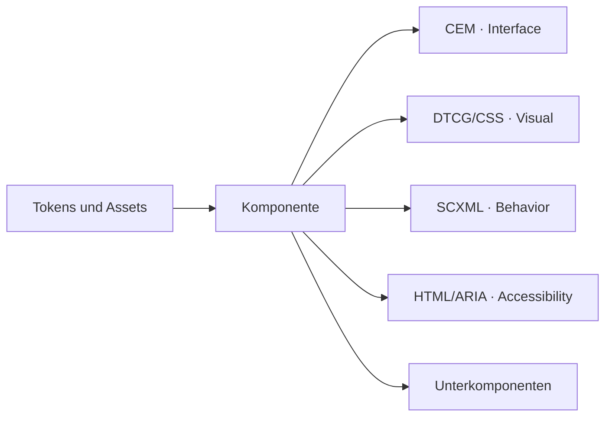

# Architektur: vier führende Domänen, explizite Verbindungen

**Eine Komponente wird aus getrennten Originalquellen beschrieben.** `component.json` verbindet sie mit ihren Teilen, Fällen und Unterkomponenten. Bibliotheksweite Tokens und Assets werden gemeinsam referenziert.

| Domäne | Führende Grundlage | Zweck |
| --- | --- | --- |
| Technisches Interface | CEM (Interface) | Properties, Typen, Events und Payloads |
| Visuelles Design | DTCG/CSS (Visual) | Tokens, Maße, Layout und visuelle Zustände |
| UX-Verhalten | SCXML (Behavior) | Übergänge, Guards, Aktionen und Lebenszyklus |
| Accessibility | HTML/ARIA, ergänzt durch APG (Accessibility) | Semantik und zugängliche Bedienmuster |

`stories.json` benennt Beispielfälle; gemeinsame Tokens und Assets bleiben am Bibliotheksroot referenziert.

Beispiel: Autocomplete hält Query, aktive Option und Commitwert getrennt; Overlay und ScrollArea haben eigene Zuständigkeiten. Gemeinsame Instanz, fachlicher Schlüssel und Lebenszyklus müssen an den Verbindungen erhalten bleiben. Gleiche Namen reichen als Zuordnung nicht.

`component.json`, ergänzende Projektionsregeln, `ux.json` und die Arbeits-/Übergabebindungen sind eigene Projektkonventionen. Sie ersetzen die Originalstandards nicht. Die UX-Eignung ergänzt die Beschreibung: Für welche fachliche Auswahl passt ein Control? Das aktive Projektprofil nutzt eine gebundene native DMN-Policy mit ausgewiesenen Grenzen.

## Wissen zugänglich halten

Skills enthalten die wiederverwendbare Handlungsessenz. Rollen erhalten Quellenverweise und genau benötigte Vorgängerartefakte. Fachliche Details führen weiterhin die ausgewählten Originaldateien; der [Gesamtabgleich](../skills/ui-contracts/references/integration-review.md) kontrolliert am Ende Anforderungen, vier Domänen und Integration.

Das ist eine Informations- und Arbeitsarchitektur, kein Beweis guter Modellleistung. Einzelprüfungen und passende Gesamtprüfung bleiben nötig. Ein Designartefakt beweist weder Webereignisse noch Screenreaderverhalten.

[Dateiaufbau der Bibliotheken](../libraries/README.md) · [Autorenregeln](../skills/ui-contracts/references/authoring.md) · [Fachliche Integrationsherleitung](research/INTEGRATION-PROFILE.md) · [Aktueller Nachweisstand](STATUS.md)
