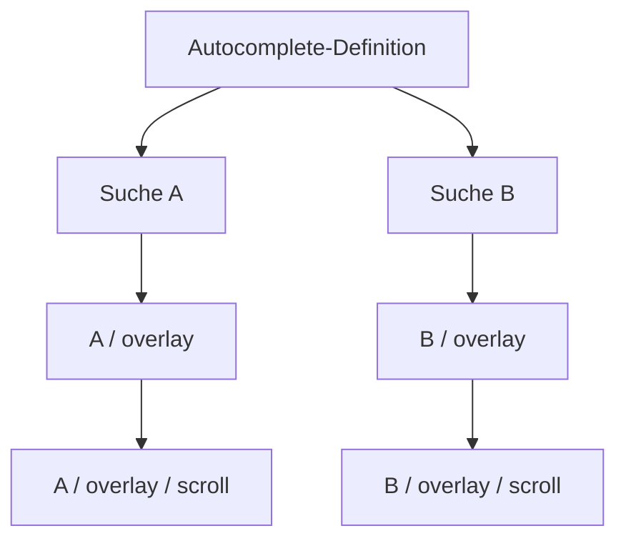

# Gemeinsames Integrationsprofil IP-01

Stand: 25. Oktober 2026. **Reviewbarer Vorschlag für einen ersten Webreferenzlauf.** Er führt die vorhandenen Ergebnisse zu einer konkreten Arbeitskombination zusammen. Er ist keine beschlossene Produktarchitektur und kein verabschiedetes neues Dateiformat. Ein ausgewählter gemeinsamer [Browserreferenzlauf](experiments/2026-10-25/ip01-browser/REPORT.md) ist inzwischen begrenzt bestanden; die gesamte IP-Abnahme bleibt offen.

**Kennzeichnung:** **B** = im verlinkten, begrenzten bisherigen Versuch belegt; **V** = vorgeschlagene Regel dieses Profils; **O** = noch erforderlicher Nachweis oder offene Auswahl. Keine V-Regel wird durch ihre Aufnahme zu einem neuen Originalstandardbefund. Matrix und Zähler bleiben bei 2 U, 543 Claims, 702 Bedingungen in 106 Gruppen.

## 1. Arbeitsvorschlag und Ergebnis des Abgleichs

**V:** Für denselben Referenzfall CEM als Interface, DTCG plus CSS als Visual, SCXML als Behavior sowie HTML/WAI-ARIA mit referenziertem APG-Muster als Accessibility verwenden. Eine kleine zusätzliche Verbindungsbeschreibung führt ausschließlich Identität, konkrete Quellziele, Instanzzuordnungen, Ableitungen und Konfliktregeln zusammen. Fachdefinitionen verbleiben in ihren Domänen.

**B:** Genau diese Rollen sind in mehreren tatsächlichen Original-/Adapterversuchen verwertbar; vier getrennte Quellen, Typ-/Eventbindungen, native Geometrie, Fokus, Scrollen und AX-Rückmeldung sind jeweils begrenzt ausgeführt. **O:** Ein ausgewählter Hostablauf mit zweistufiger Komposition, Ergebnisdaten, Events/Fokus/Scroll-/AX-Folge ist inzwischen ausgeführt; vollständige Änderungs-/Theme-/AT-/Nativevarianten bleiben offen. Ein [gemeinsames statisches Paket](experiments/2026-10-25/ip01-static/REPORT.md) liegt inzwischen mit 27 erfüllten Erwartungen vor; dessen tatsächliche Dateien, T0/T1-Prüfung und Bindungen ersetzen die vollständige Laufzeitfolge nicht.

**V:** Ziel dieser Runde ist ein überprüfbarer Referenzcontract für zwei gleichartige Autocomplete-Verwendungen. Die Wahl eines produktiven Frameworks, eine native Ausgabe und eine öffentliche Komponentenbibliothek folgen daraus nicht. Die abweichenden Anforderungen eines anderen Widgets bleiben eigene Definitionen.

## 2. Konkrete Originalstände und ihre Rollen

Die Auswahl verwendet vorhandene Pins; sie ist keine neue Recherche nach neuesten Releases. Normstand, Werkzeug und eigene Fixture sind verschiedene Gegenstände. Hashes bezeichnen jeweils die im Manifest dokumentierte Lesefassung oder konkrete lokale Datei, nicht automatisch bytegleiche HTTP-Antworten.

| Rolle | Vorgeschlagener Stand | Beleg / Grenze |
| --- | --- | --- |
| Interface | CEM-Schemastand am Commit `2570079a0525c26296f9ec39944f0c6e0f0461af`; Fixture-`schemaVersion` 2.1.0 | **B:** Originalschema und einfache Properties/Parts/Eventmetadaten. [Schemaherkunft](experiments/2026-10-24/source-manifest.json), [tatsächliche Payloadbindung](experiments/2026-10-25/css-complement-runtime/REPORT.md). Typtext allein prüft keine Eventwerte. |
| Visualwerte | DTCG Format Module 2025.10 | **B:** Zusätzlicher dimension-/Alias-Übersetzer und px/rem-Browserfälle. [Bericht](experiments/2026-10-25/dtcg-binding/REPORT.md). Kein vollständiger DTCG-Validator oder Resolver-Kontextnachweis. |
| Webgeometrie | CSS Anchor Positioning 1, WD 27.03.2026; CSS Overflow 3, WD 07.10.2025 | **B:** Begrenzte Originalgrammatikbindung und native Ziel-/Overflowfälle. [Grammatikpins](experiments/2026-10-25/css-original-grammar/source-manifest.json), [Ankerbezüge](experiments/2026-10-25/css-semantic-anchors/REPORT.md), [native Folgeprüfung](experiments/2026-10-25/layout-final-bindings/REPORT.md). Working Drafts; kein allgemeiner Browsersupport zugesagt. |
| Verhaltensmodell | SCXML 1.0, REC 01.09.2015; für die Referenz ausdrücklich ECMAScript-Datenmodell | **B:** Original-XSD und echte Zustands-/Daten-/Parentereignisse. [Quellenregister](SOURCES.md), [Runtime](experiments/2026-10-25/scxml-runtime/REPORT.md). Kein automatischer Swift-/Native-Export. |
| Forschungsruntime | `@scion-scxml/scxml` 4.3.28, Lockdatei und Originaldateihashes aus dem vorhandenen Versuch | **B:** Direkte Instanzen mit frischer Vorbereitung; begrenzter isolierter Childadapter. [Runtimepin](experiments/2026-10-25/scxml-runtime/source-manifest.json), [Invoke-Gegenbefund und Adapter](experiments/2026-10-25/scxml-invoke/REPORT.md). Der Defaultinvoker ist für gleiche Childquelle hier nicht hinreichend isoliert. |
| Zugängliche Semantik | WAI-ARIA 1.2, REC 06.06.2023, mit HTML-Hostbezug | **B:** Rollen/Relations-/Namensbindung und tatsächliche AX-Beobachtung. [Befund](experiments/2026-10-25/css-complement-runtime/REPORT.md). HTML ist Webhost und kein neues neutrales A11y-Schema. |
| Bedienanforderung | APG-Combobox-Listbox-Muster am Pin `0f765e4dc33e966026114ac12a8380db1de3b787` | **B:** Quellenbezug und begrenzte Keyboard-/Fokusfolgen. [Quellenreview](experiments/2026-10-25/css-complement-runtime/source-review.json). APG ist informativer Guide, keine universelle Contractdatei oder Laufzeitgarantie. |

**V:** CEM, DTCG und SCXML bleiben in ihrer jeweiligen Originalsyntax; Verbindungsfelder werden nicht in deren Schemas eingeschoben. Vier **logische Domänen** bedeuten nicht exakt vier physische Dateien: Tokens und Layout gehören gemeinsam zu Visual; drei Komponentendefinitionen besitzen jeweils eigene Teilbeiträge.

**V:** UXSpec/XState/Zag, Panda, OpenPencil und die weiteren untersuchten Beiträge bleiben Alternativen für gesonderte Varianten. Ihre positiven Einzelbefunde werden nicht pauschal auf IP-01 übertragen. Google/OpenUI-X06 bleiben offen, verhindern aber keinen Referenzlauf ohne diese beiden Beiträge.

## 3. Artefakte und minimale zusätzliche Beschreibung

**V – illustrativer künftiger Dateibaum, noch nicht erzeugte Paketdateien:**

```text
reference/
  autocomplete/   interface.json · behavior.scxml · accessibility.html · visual/layout.css
  overlay/        interface.json · behavior.scxml · accessibility.html · visual/layout.css
  scroll-area/    interface.json · behavior.scxml · accessibility.html · visual/layout.css
  visual/         tokens.light.json · tokens.dark.json
  integration/    bindings · resolved-sources
  generated/      CSS-Variablen und Zielabbildungen
```

`bindings` und `resolved-sources` sind Inhaltsrollen, keine verabschiedeten Dateinamen oder Schemas. **V:** Als erster maschinenlesbarer Träger bietet sich JSON an, weil die vorhandenen Zusatzprofile es nutzen; YAML mit eindeutig festgelegter Normalisierung bleibt eine Alternative. Die Entscheidung betrifft die Verbindungen, keine neue Sprache für Tokens, Properties oder Maschinen.

| Inhalt der zusätzlichen Beschreibung | Darf enthalten | Bleibt in der führenden Domäne |
| --- | --- | --- |
| Definitionen / Verwendungen | Quellreferenzen, Zielarten, Definition- und Instanzpfade | Öffentliche Signatur, eigentliche Maschinen, Tokenwerte, Rollen-/Patternanforderungen |
| Beziehungszuordnung | CEM-Part → Hosttarget; Zustand → vorhandener Visual-/A11y-Verbraucher; Event → deklarierter Port | Eigentliche Übergangsbedingungen, CSS-Regeln und zugängliche Bedeutungen |
| Quellabschluss | Exakt aufgelöste Revisionen/Hashes und Adapterstände | Kein zweites editiertes Originalartefakt |
| Änderungsbezug | Führender Feldpfad, abgeleitete Orte, betroffene Prüfungen | Kein automatischer Vorrang durch Dateireihenfolge |
| Adapterumfang | Unterstützte Locator-/Typ-/Einheitsteilmenge und eindeutige Fehler | Keine still erfundene Originalfähigkeit |

**B:** Mehrere tatsächliche Zusatzbinder lösen konkrete fehlende Verbindungen. **V:** Ihre gemeinsamen Begriffe hier konsolidieren; keinen vorhandenen Einzelprüfer unverändert als universellen Resolver ausgeben. **O:** Ein verbindliches Schema für diesen kleinen Träger und ein gemeinsamer Prüfeinstieg entstehen erst aus dem reviewten Profil. Der [minimale Bindungsentwurf](INTEGRATION-BINDING-DRAFT.md) präzisiert jetzt Struktur, Zielarten, Instanzprüfung und Diagnosen; seine Beispielpfade/Null-Locator sind ausdrücklich noch nicht ausführbar.

## 4. Definition, Instanz, Teil und Revision

**V:** Eine Definition besitzt Bibliotheksnamespace, lokalen Definitionsnamen und eine exakt aufgelöste Revision. Eine Verwendung besitzt einen vollständigen Instanzpfad. Ein Part hat seine Bedeutung innerhalb der betreffenden Definition. Diese Begriffe sind weder eine URI-/URN-Festlegung noch konkrete DOM-IDs.



| Katalogname im Vorschlag | Verwendete Definition | Konkreter Kontext |
| --- | --- | --- |
| `A`, `B` | dieselbe Autocomplete-Revision | Eigene Query, Ergebnisse, aktive/gewählte Werte, Request- und Lifecyclegeneration |
| `A/overlay`, `B/overlay` | dieselbe Overlay-Revision | Eigene sichtbare Fläche und eigene Invoke-/Hostsession |
| `A/overlay/scroll`, `B/overlay/scroll` | dieselbe ScrollArea-Revision | Eigener Viewport, tatsächlicher Scrolloffset, eigener Reveal-Auftrag |
| `A/option[key]`, `B/option[key]` | wiederholter fachlicher Option-Part von Autocomplete | Identität aus Datensatzkey innerhalb der jeweiligen Suche, nicht Listenindex |

**V:** Domänenreferenz = Artefaktrolle + tatsächlich gebundener Quellenstand + expliziter Locator + geprüfte Zielart/Definitionszugehörigkeit; ein Instanzziel benötigt zusätzlich den Verwendungspfad. Gleiche Namen reichen nicht. Ein CEM-CssPart ist zunächst ein Stylingpart; erst die zusätzliche Bindung identifiziert einen konkreten Input, eine Listbox oder einen Viewport.

**V:** Web-IDs und CSS-Ankernamen werden daraus abgeleitet und innerhalb des Hosts eindeutig erzeugt. Lokale SCXML-Invoke-IDs `overlay` und `scroll` dürfen unter verschiedenen Eltern gleich sein; die Route muss Elternsession, lokalen Invoke und Lifecyclekontext unterscheiden. Weder ein Payloadfeld `owner` noch eine DOM-ID ersetzt diesen Kontext. Das ist semantische Zuordnung, keine behauptete Authentifizierung.

**V:** Der erste Referenzlauf verwendet verschachtelten DOM ohne Portal und ohne Virtualisierung. Ein anderer Host braucht ein eigenes, ausdrücklich geprüftes Zielprofil; dadurch werden andere zulässige ARIA-Strukturen nicht pauschal ungültig.

## 5. Vollständige Rollen der drei Komponenten

| Definition | Eigene Teile / Eingänge / Ausgänge | Zuständigkeit |
| --- | --- | --- |
| Autocomplete | `input`, `list`, `option`, `status`, Verwendung `overlay`; Query/Ergebnisdaten; öffentliches `value-change` | Besitzt Daten- und Auswahlsemantik, erkennt Nutzernavigation/Bestätigung, fordert Sichtbarmachen an. |
| Overlay | `surface`, `content`; Sichtbarkeit aus Elternzustand; logischer Bezug auf Autocomplete-Input; Verwendung `scroll` | Lebenszyklus der Oberfläche und ihres Inhalts. Keine zweite Such-/Auswahlmaschine und kein eigenes konkurrierendes Öffnen durch dieselbe Taste. |
| ScrollArea | `viewport`, `content`; `REVEAL(key, requestId)`; `REVEALED(key, requestId, visible)` | Stellt die eigene Scrollfunktion bereit und meldet tatsächliche Sichtbarkeit. Besitzt keine Suchergebnisse oder bestätigte Auswahl. |

**V:** Die Autocomplete-Listbox liegt im Inhalt der eigenen ScrollArea. Overlayfläche, Scrollviewport und semantische Listbox sind drei ausdrücklich verschiedene Ziele. `aria-controls` des Inputs adressiert die Listbox, der CSS-Anker die Overlayfläche, der Reveal-Auftrag den Viewport. Eine Zusammenlegung wäre eine andere, eigens zu prüfende Anatomieentscheidung.

**V:** Overlay und ScrollArea erzeugen im gewählten Profil keine zusätzliche Dialog-/Regionrolle und keinen eigenen Tabstopp. Ihr Accessibilitybeitrag beschreibt den neutralen Container-/Inhaltsbezug und erforderliche Sichtbarkeit. Die Listbox-/Optionsrollen und der Name der Suchinstanz bleiben bei Autocomplete. Ein später separat bedienbarer Scrollbereich braucht ein anderes Fokusprofil.

**O:** Die bisherigen Childmodelle `ResearchScrollArea` mit owner/offset sind nur Teilbelege. Sie enthalten nicht diese vollständigen Ports, Anatomie, DOMmessung und zweistufige Komposition.

## 6. Typen, öffentliche Schnittstelle und Daten

**V:** Ein kleiner, expliziter Typumfang genügt für den ersten Fall; keine Auswertung beliebiger CEM-Typtexte. Ein normalisierter Typsichtbaum wäre eine **Ableitung** aus CEM und kein zweiter führender Vertrag.

| Umfang | Vorgeschlagene Bedeutung | Evidenzstatus |
| --- | --- | --- |
| T0 | string, boolean, endliche number; erforderliche Felder und ausdrücklich vorhandene/fehlende optionale Felder | **B:** Begrenzte primitive Property-/Payloadzuordnungen. Nicht jede Kombination geprüft. |
| T1 | Homogene Ergebnisliste mit nichtrekursiven Records `{key:string, label:string, disabled?:boolean}` | **V/O:** Für den vollständigen Suchfall erforderlich; verschachtelte Laufzeitprüfung im gemeinsamen Paket noch zu implementieren und nachzuweisen. |
| Nicht unterstützt im ersten Profil | beliebige generische Typen, rekursive Objekte, Funktionen, Klassenidentität, implizite String/Zahl-Konvertierung | **V:** Als nicht unterstützt melden, nicht als bestandene Prüfung oder generell ungültiges Originalmodell. |

**V – öffentliche Autocomplete-Semantik:**

- `query:string` ist der aktuelle Eingabeentwurf; er darf leer sein. Nutzereingabe und externe Queryänderung werden als Befehle an dieselbe Behaviorinstanz behandelt.
- `value?:string` bezeichnet den zuletzt bestätigten Datensatzkey. Fehlend bedeutet keine Bestätigung; `null` wird im ersten Typumfang nicht still gleichgesetzt. Keys sind in einer Ergebnismenge eindeutig und nicht leer.
- `results` folgt T1. Ein Ergebnis mit demselben Key behält bei Umordnung seine fachliche Identität; doppelte Keys werden abgewiesen.
- `value-change` trägt ausschließlich `{value:string}` und wird im Vorschlag einmal bei ausdrücklicher Nutzerbestätigung emittiert. Das entspricht dem einfachen bisherigen Payloadpfad; die neue vollständige Maschine muss den Zeitpunkt gemeinsam nachweisen.
- Programmatische Wertsetzung wird als eigener Befehl nur für einen bekannten aktuellen Ergebniskey akzeptiert, aktualisiert Wert/angezeigtes Label und erzeugt kein zweites Nutzerbestätigungsereignis. Unbekannter Key führt zu einer Parameterdiagnose.

**V:** Queryentwurf und bestätigter Wert sind getrennt. Während neuer Eingabe bleibt der letzte bestätigte Key erhalten; bloßes Tippen emittiert keine Bestätigung. Alternativ wäre automatische Rücknahme der Auswahl möglich, würde aber eine ausdrücklich definierte Clear-/Eventsemantik benötigen. Diese Produktvariante wird nicht still mit IP-01 vermischt.

**V:** Interne Requestnummern sind nichtnegative exakt darstellbare Ganzzahlen im festgelegten Bereich. Kombination aus Instanzpfad, Lifecycle-Epoche und laufender Nummer identifiziert eine Anfrage; Erschöpfung darf nicht durch kollidierendes stilles Zurücksetzen behandelt werden. Providerdaten sind Anwendungsdaten, keine fünfte Contractdomäne: Interface beschreibt ihre Form, Behavior bestimmt, welche Antwort aktuell ist.

## 7. Ereignisse und ausgewählter Ablauf

**V:** Editierbare Combobox mit manueller Listenauswahl; freie Queryeingabe ist erlaubt, ein freier Text wird nicht als neuer Datensatzwert bestätigt. Sieben Ergebnisse sind ein Testdatensatz. Die folgenden Abläufe sind Arbeitsannahmen für die Abnahme, keine allgemeinen APG- oder Produktpflichten.

| Zustand | Eigene Quelle / erlaubte Wirkung | Visual-/A11y-Projektion |
| --- | --- | --- |
| `closed` | Keine aktive Childverwendung; bestätigter Wert kann bleiben | Oberfläche verborgen, expanded=false, kein active-descendant |
| `active.opening` | Eigenes Overlay und dessen ScrollArea werden vorbereitet; alte Requests ungültig | Noch verborgen/expanded=false; Fokus bleibt Input |
| `active.loading` | Children bereit; aktuelle Queryanfrage läuft | Oberfläche sichtbar, expanded=true, keine aktive Option; Ladefeedback |
| `active.ready` | Aktuelle nichtleere Ergebnisliste | Navigation nur über aktivierbare Optionen; aktive Option gegebenenfalls leer |
| `active.empty` | Aktuelle Ergebnisliste leer | Kein aktives Ziel, keine Bestätigung, Leermeldung |
| `active.error` | Providerfehler bei verfügbarem Overlay | Kein aktives Ziel; vereinbarte Fehlerrückmeldung, bestätigter Wert bleibt |

**V:** Öffnen durch ArrowDown startet die eigene Verwendung. Nach aktueller Antwort aktiviert dieser Navigationseinstieg die erste aktivierbare Option. Öffnen durch Tippen startet eine Anfrage, übernimmt aber nicht automatisch eine Option. Reiner Fokus öffnet im vorgeschlagenen Fall nicht; ein abweichender Focus-open-Vertrag wäre ausdrücklich eine andere Variante.

**V:** ArrowDown/ArrowUp in `ready` bewegen unter Beachtung deaktivierter Optionen, zunächst ohne zyklisches Umspringen. DOM-Fokus verbleibt im Input. Enter mit aktiver aktueller Option übernimmt deren Key und Label, emittiert genau einmal `value-change` und schließt. Enter ohne aktivierbare Option bestätigt nichts. Escape schließt ohne neue Bestätigung; native Texteingabetasten bleiben erhalten. Eingabekomposition darf nicht durch vorzeitige Navigation/Bestätigung unterbrochen werden.

**V:** Fachliche Navigationsaktionen gehören in Behavior. Beispielsweise ist „nächste Option“ konkret: aktuellen Key in der aktuellen geordneten Keyliste finden, in gewählter Richtung bis zur nächsten nicht deaktivierten Option suchen, an der Grenze stehenbleiben; ohne bisherigen Key erste beziehungsweise letzte aktivierbare Option wählen; bei leerer Menge activeKey löschen. Keine unbestimmten Guard-/Actionnamen als fertige Semantik akzeptieren. Die spätere SCXML/ECMAScript-Implementierung dieser Regel gehört zum Behaviorartefakt, nicht zu einer heimlich entscheidenden Integrationsschicht.

**V:** Eine neue Query invalidiert die alte Anfragenummer und aktive Option. Eine Antwort wird nur bei passender Instanz, Epoche und aktueller Anfrage übernommen. Späte Ergebnisse werden nachvollziehbar verworfen, ohne fremde Instanzen zu ändern. Bei Umordnung bleibt ein vorhandener aktivierter Key erhalten; bei Entfernung wird activeKey gelöscht. Ein bestätigter Key wird dadurch nicht automatisch neu bestätigt oder überschrieben.

**O:** Lade-/Fehler-/Leerzustände, Ergebnisrecords, programmatische Änderungen und vollständige Eingabekomposition sind neue gemeinsame Abnahmefälle; die bisherigen simplen closed/open/selected-Maschinen beweisen sie nicht.

## 8. Drei Bedeutungen der Auswahl

| Information | Führende Bedeutung im Vorschlag | Ableitung |
| --- | --- | --- |
| `activeKey` | Behavior: aktuell navigierter Key, gegebenenfalls fehlend | Visuelle Hervorhebung; Reveal-Auftrag; aktives zugängliches Ziel |
| Gemeldete Popupauswahl | Accessibilityregel des gewählten Listboxmusters: folgt hier activeKey | `aria-activedescendant` am Input; `aria-selected` an genau der aktiven Option |
| `value` | Behavior: zuletzt ausdrücklich bestätigter Key | Öffentliches Event erst beim Commit; bleibt bei bloßer Navigation unverändert |

**V:** Diese Zuordnungsregel steht in Accessibility beziehungsweise in der zusätzlichen Verbindung zu Behavior; eine zweite manuell gepflegte Auswahlvariable für ARIA ist nicht vorgesehen. Die Wörter active/selected/value allein begründen keine Gleichheit.

## 9. Komposition und Lebenszyklus ohne geteilte Daten

**V:** Autocomplete verwendet Overlay; Overlay verwendet ScrollArea. Jede neue Verwendung bereitet die originale Modellfunktion frisch vor und erhält eigene Daten/Parameter. Gleiche Definitionsbytes und dieselbe lokale Invoke-ID dürfen keine gemeinsamen Laufzeitdaten erzeugen.

**B:** Beim Defaultinvoker 4.3.28 wurden trotz getrennter Eltern bei gleicher Childquelle gekoppelte Kinddaten beobachtet. Ein enger eigener Invoker mit frischer Vorbereitung besteht sechs kontrollierte Bedingungen. **O:** Er akzeptiert bisher nur eine bestimmte lokale Childdatei; zweistufige Auflösung, Initialisierungsrennen, Fehlerpropagation und Wiederherstellung sind nicht damit erledigt. Der [anschließende Zweiebenenversuch](experiments/2026-10-25/ip01-lifecycle/REPORT.md) erfüllt sechs von acht Erwartungen; sofortiges Reopen verliert den neuen Invoke-Sendpfad und Initialisierungsfehler erreichen den vorgesehenen Parentübergang nicht. Diese beiden Blocker bleiben im ersten Pfad erhalten. [Gezielte Folgevarianten](experiments/2026-10-25/ip01-followup/REPORT.md) bestehen sechs neue Bedingungen und acht nicht erneut gezählte Regressionen: Native idlocation und ein expliziter Fehlerrelay umgehen die beiden Grenzen im ausgewiesenen lokalen Forschungsadapter. Die vollständigen IP-Gates bleiben offen. Die URI-Dateikopie-Diagnose ist keine empfohlene Produktlösung.

**V – Referenzruntime-Vorschlag:** Den vorhandenen isolierenden Adapter für einen exakt aufgelösten lokalen Definitionsbestand erweitern; jeden Parent und jedes Kind frisch vorbereiten, Inputs explizit übergeben und ursprüngliche send-/Parent-/Cancel-Mechanismen erhalten. Kein gemeinsamer vorbereiteter Funktionscache als Ausführungskontext. Alternative: eine andere Runtime oder explizite Hostkomposition mit neuem Nachweis; kein automatischer Transfer der bisherigen Ergebnisse.

**V – Protokoll:**

1. OPEN erzeugt eine neue Lifecycle-Epoche und startet genau das eigene Overlay; dieses startet genau seine ScrollArea.
2. READY bestätigt angelegte gültige Kindkontexte. Erst die passende Rückmeldung lässt Autocomplete aus opening weitergehen. Der Overlay-Sichtbarkeitswert ist eine Ableitung des Elternzustands, keine zweite autonome Öffnungsentscheidung.
3. Ein Reveal wird erst nach vorhandenen aktuellen Zielknoten und gültiger Layoutmessung abgeschlossen. Modell-READY allein beweist keine sichtbare gemessene Box.
4. ScrollArea löst `REVEAL(key, requestId)` nur innerhalb ihres eigenen Inhalts auf. Sie verwendet die tatsächliche Scrollfunktion, liest tatsächlichen Offset/Sichtbarkeit zurück und meldet REVEALED. Ein übergebener Wunschoffset wird nicht als gemessener Offset ausgegeben.
5. CLOSE invalidiert Provider- und Reveal-Aufträge, beendet ScrollArea und Overlay und entfernt alle zugehörigen Views/Bezüge. Der Input bleibt bestehen; aktives Nachfahrenziel wird vorher bereinigt.
6. Ein verspätet fertig erzeugtes Kind einer geschlossenen Epoche wird beendet und nicht nachträglich gestartet/eingehängt. Wiederöffnen erzeugt frische Daten; B bleibt unverändert.
7. Fehler bei Childinitialisierung schließen den nicht nutzbaren Overlaykontext und melden über die weiterhin vorhandene Statusregion. Providerfehler bei funktionsfähigem Overlay nutzen dagegen active.error.

**V:** ScrollArea verarbeitet dieselben Arrow-Tasten nicht zusätzlich als Auswahl. Autocomplete entscheidet über Navigation; der Child erfüllt nur den daraus gebundenen Reveal-Auftrag. Cancel und erneutes Öffnen sind Teil des Vertrags, nicht reine Aufräumdetails.

## 10. Visual, Tokens, Themes und Geometrie

**V:** Alle Zahlen und Einheiten führen die Visualquellen. Beziehungen referenzieren diese Werte, sie duplizieren keinen zweiten führenden Abstand oder eine zweite Maximalhöhe.

- Referenzwerte: Abstand 8px, Viewport-Maximalhöhe 160px, sieben gleich hohe Zeilen zu je 32px. Feste Zeilen erfordern eine ausdrückliche Nichtschrumpf-Regel; der tatsächliche Flex-Gegenbefund bleibt relevant.
- Die Overlayfläche bezieht sich auf die eigene Inputkante; das Webprofil bindet Unterkante und gleiche linke Kante bei horizontalem LTR-Layout. Größenänderungen müssen die Relation erhalten.
- ScrollArea verwendet im Referenzfall auto. Clip wäre gültiges CSS, verletzt aber den hier geforderten Reveal-Fähigkeitsvertrag und wird als Konflikt zwischen Politik und Anforderung gemeldet.
- Bei gleich hohen Zeilen entspricht 160px fünf Zeilen. Bei variablen Zeilen bleibt die geometrische Grenze maßgeblich; „immer fünf vollständige Optionen“ ist keine abgeleitete Garantie.
- DTCG-Zahl und Einheit bleiben erhalten. rem wird durch die tatsächliche Rootschriftgröße bestimmt, nicht pauschal in einen scheinbar identischen px-Skalar verwandelt.

**V:** Light/Dark zunächst durch explizite Auswahl vollständiger Visual-Tokenquellen mit gleichen semantischen Tokenpfaden führen; Auswahlregel gehört zu Visual/Hostkontext. Das ist eine zusätzliche klare Themenbindung, keine erfundene native DTCG-Dark-Mode-Syntax. Interface, Behavior und A11y werden durch Themewechsel nicht neu definiert.

**O:** Bisherige DTCG-Bridge beweist nur ihren dokumentierten dimension-/Aliasumfang. Vollständige Farbübersetzung und gemeinsamer Themewechsel sind neue Abnahmefälle. Unterstützte Farbteilmenge und Übersetzung müssen am Originalmodell festgelegt und geprüft werden; DTCG-Konformität sämtlicher Tokenarten wird nicht behauptet. Collision-/Clippingfallbacks am Bildschirmrand, RTL und weitere Schreibmodi sind ausdrücklich spätere Zielvarianten.

## 11. Accessibility und Datenrückmeldung

**V:** Inputname aus dem instanzbezogenen Labelparameter; Listboxname aus einer in A11y festgelegten Benennungsregel. Optionsname stammt gemäß A11y-Regel aus `result.label`. Datenquelle liefert den Text, A11y definiert dessen zugängliche Verwendung; keine duplizierte Liste manuell gepflegter Optionsnamen.

**V:** Zustandsprojektion liefert expanded, busy und active-descendant aus tatsächlicher passender Behavior-/Hostlage. Vor dem Entfernen einer aktiven Option wird ihr Bezug bereinigt. Ziel muss existieren, die verlangte Rolle besitzen und im unterstützten Beziehungsbereich derselben Suche liegen.

**V:** Eine eigene status/polite/atomic-Region pro Suche meldet relevante Lade-/Ergebnis-/Fehler-/Bestätigungsänderungen. Auslöser kommt aus Behavior; Meldungsvorlage/Locale aus A11y. Fokus springt dafür nicht in die Statusregion. Eine reine CSS- oder Themeänderung erzeugt kein Auswahlereignis und keine erfundene Ergebnisansage. Späte verworfene Daten werden nicht als neue Ergebnisse verkündet.

**B:** Native AX-Live-/Atomic-Eigenschaften und tatsächlicher Text sind für einen begrenzten Bestätigungsfall beobachtet. **O:** Vollständige Meldungsabfolge, Sprachvarianten und echte Assistenztechnik sind im gemeinsamen Profil noch zu prüfen. Ein AX-Baum ist keine bestätigte Screenreader-Sprachausgabe; eine automatische Regelprüfung ersetzt diese Prüfung nicht.

## 12. Führende Quelle je Information und Konfliktentscheidung

| Information | Führend | Zulässige Ableitung / Konflikt |
| --- | --- | --- |
| Öffentlicher Name, Typ, Optionalität, deklarierter Default | Interface/CEM | Typsicht und Bridge-Signaturen daraus ableiten; kein eigener inkompatibler Payload in Behavior. |
| Aktuelle Query, gültige Ergebnisgeneration, activeKey, Bestätigungszeitpunkt | Behaviorinstanz auf validierten Eingaben | Visual/A11y lesen projizierten Zustand; Integrator entscheidet nicht zusätzlich über Auswahl. |
| Ergebnislabels/-keys | Validierter Providerdatensatz nach Interfaceform und Behavior-Annahme | A11y verwendet Labels gemäß ihrer Regel; falsche oder veraltete Generation ablehnen/verwerfen. |
| Tokenwerte, Geometrie, Theme und Overflowpolitik | Visual | CSS-/Hostwerte daraus ableiten; Quelle ändern statt generierte Variablen eigenständig pflegen. |
| Namen-/Rollen-/Relations-/Meldungsregeln und Patternanforderung | Accessibility | Hostattribute und Meldungen ableiten; widersprechende Keyboard-/Fokusbindung ist ein gemeinsamer Konflikt. |
| Tatsächlicher Scrolloffset, Sichtbarkeit und DOM-Lage | Zielhostmessung | ScrollArea meldet beobachteten Zustand; Wunschwert ist kein Messwert. |
| Definition-/Instanz-/Part-/Quellzuordnung | Integrationsbeschreibung | Vorhandene Originalidentität wiederverwenden; Zielarten/Revisionen prüfen. |

**V:** Bei Konflikt keine allgemeine „Datei X gewinnt“-Regel. Beteiligte führende Stellen und verletzte Beziehung melden. Änderungen zuerst an der führenden Information vornehmen und alle deklarierten Ableitungen konsistent erneuern. Ein direkter Derived-Edit wird abgewiesen, solange er nicht als Quelle neu begründet wird. Fachlich unvereinbare Quellen bleiben inkonsistent; ein vorhandener Zielknoten allein schafft keine Kompatibilität.

**B:** Zwei konkrete Änderungs-/Konfliktketten und externe CEM→Fact→Output-Führung wurden ausgeführt. **O:** Allgemeine dauerhafte Mehrdateitransaktionen, konkurrierende Prozesse, Autorisierung und verlustfreier Roundtrip sind damit nicht belegt.

## 13. Auflösung, Versionen und Änderungsprotokoll

**V:** Im ersten Referenzlauf ausschließlich den exakt aufgelösten lokalen Paketabschluss verwenden. Zu jeder Quelle tatsächliche Datei-/Modellversion, Inhaltsfingerprint, Adapterstand und ihre fachliche Rolle aufzeichnen. Keine implizite Aktualisierung über latest oder einen neu aufgelösten Versionsbereich. Originalnorm, Paketversion und eigene Komponentendefinitionsrevision bleiben getrennt.

**V:** Erst Originalartefakte laden/prüfen, dann typisierte Ziele/Definitionen, danach Verwendungen/Beziehungen und schließlich tatsächliche Runtime. Fehlende Originalvalidatoren werden als solche ausgewiesen. ARIA/APG erhalten kein erfundenes neutrales Dateischema; der DTCG-Teilprüfer wird nicht zum umfassenden Originalvalidator erklärt.

**V:** Hashpins müssen sowohl nach semantisch absichtlichen Testmutationen als auch nach abgeleiteten Änderungen nachvollziehbar aktualisiert werden. Referenzvorschlag für die Bündelrevision ist der bereits konsistent geprüfte eigene Algorithmus aus [Ownership](experiments/2026-10-25/ownership-conflicts/run.py): deterministisch serialisierte Dateihashmap plus Policyhash. Derselbe Algorithmus gilt für Ausgangs- und Folgerevision. Seine genaue Paketfeldzuordnung ist noch kein publizierter Standard.

**V:** Migration erfolgt als neue Revision mit dokumentiertem Mapping und erneuter betroffener Abnahme. Umbenennung ist kein stiller identischer Namensfund. Erstes Komponenten-Verwendungsprofil hat endliche azyklische AC→Overlay→ScrollArea-Expansion; rekursive Komponentenverwendung wird als im Profil nicht unterstützt gemeldet. Zustandsmaschinen-Schleifen sind dadurch nicht verboten. Tokenaliaszyklen und unauflösbare Abhängigkeiten sind eigene Fehlerarten.

**V:** Diagnose enthält Regelkennung, Quellrevision, Locator, Definition/Instanzpfad, erwartete/tatsächliche Zielart beziehungsweise Werte und beteiligte führende Quellen. Ein nicht unterstützter Ausdruck, ein ungültiges Originalartefakt, ein Bindungskonflikt und eine verworfene späte Antwort sind unterschiedliche Ergebnisse.

## 14. Zusammenhängende Abnahme statt Addition alter Versuche

Der [Abnahmeplan IP-01](INTEGRATION-ACCEPTANCE.md) definiert neue geplante Erwartungen für **ein** aufgelöstes Paket. Keine seiner Zeilen ist durch dieses Dokument bereits ausgeführt. Bestehende Teilbelege sind jeweils verlinkt; verbleibende Abnahmelücken bleiben sichtbar.

**V:** Positive A/B-Folge: Start geschlossen → A öffnet/Children bereit → aktuelle Ergebnisse → aktive Navigation/Reveal → expliziter Commit → öffentliches Event/Status/Cancel → unabhängiges B → erneutes A mit frischer Epoche. Zusätzlich Queryrevisionen, vertauschte Antworten, Umordnung, entfernte aktive Option, leere/fehlerhafte Daten und Theme-/Geometrieänderung.

**V:** Negative Varianten beschädigen jeweils genau eine Beziehung. Bei semantischen Gegenfällen Integritätspins bewusst korrekt aktualisieren, damit ein bloßer Hashfehler nicht alle Ziel-/Typ-/Instanzfehler verdeckt. Original- und Zusatzdiagnosen bleiben getrennt. Gemeinsame Bedingungen nicht mehrfach zählen, wenn sie mehrere Kriterien stützen.

**O – Abnahmetore:** T1-Daten-/Defaultprüfung; vollständige Zweiebenen-Childisolation inklusive Cancel während Initialisierung; gemeinsamer Token-/Theme-/Layoutpfad; vollständige Zustands-/Event-/Fokus-/Meldungsfolge. Erst wenn diese Tore tatsächlich ausgeführt sind, ist der gewählte Referenzlauf abgenommen. Produkt-/Browser-/AT-Support erfordert zusätzliche ausdrücklich benannte Umgebung.

## 15. Agentenablauf und spätere Übergabe

**V:** Vier fachliche Bearbeitungsrollen plus Koordination: Interface ändert Signaturen; Visual Tokens/Layout; Behavior Zustands-/Daten-/Ereignislogik; A11y Pattern/Namen/Relations-/Meldungsregeln. Koordination pflegt Referenzen/Quellenabschluss und weist fachliche Konflikte zu. Das sind Arbeitsrollen, keine bereits erstellten Skills oder authentifizierten Berechtigungen.

Ein Änderungspaket liest zuerst Pins und Zuständigkeiten, beschreibt die führende Information, ändert deren Quelle und aktualisiert ausgewiesene Ableitungen. Danach eigene Domänenprüfung, betroffene Beziehungen, Runtime-Abnahmetore und manuelle Zielprüfungen ausführen. Übergabe enthält Eingaben, Erwartungen, tatsächliche Ausgaben, Diagnosen, alte/neue Revision und verbliebene Grenzen. Forschungsergebnis, übernommene Änderung und produktive Freigabe sind getrennte Stati. Lokale Commits erfolgen nach Nutzerauftrag beziehungsweise vereinbartem großen Arbeitspaket; kein automatischer Push.

**O:** Ausführbare Skills und ein gemeinsamer Prüfaufruf bleiben späterer Implementierungsauftrag. Die [konkrete Übergabe](IMPLEMENTATION-HANDOFF.md) priorisiert den unabhängigen zweistufigen Lifecyclekern, anschließend statische Auflösung und vollständige Hostabnahme. Sie enthält auch noch zu reviewende Randfallregeln für Fokusverlust, IME, Eingaben während Initialisierung und fehlerhafte Daten. Ein Coding-Agent soll mit diesem Profil und dem Abnahmeplan beginnen können, ohne die 16 Kandidaten erneut durchzuzählen. Er darf offene Nachweise nicht durch eine neue allgemeine Daten-/Produktsprache verdecken.

## 16. Plattformumfang und tatsächlich noch zu treffende Entscheidungen

**V:** IP-01 zuerst als Webreferenz in einer benannten Browser-/Hostumgebung. Die logischen Definition-/Instanz-/Part-/Portbeziehungen sollen keine DOM-ID als universelle Identität voraussetzen. CEM-Eventwrapper, CSS-Geometrie, HTML/ARIA und SCXML-ECMAScript-Datenmodell bleiben konkrete Zielbindungen. Swift/SwiftUI und andere native Ziele benötigen eigene Typ-, Laufzeit-, Layout-, Fokus- und A11y-Mappings; aus dem Webprofil entsteht kein zugesagter nativer Support.

| Entscheidung zur Review | Konkreter Vorschlag | Offene Alternative / Grenze |
| --- | --- | --- |
| D1: Referenzkombination | Der oben gepinnte CEM/DTCG+CSS/SCXML/HTML-ARIA-Stack für einen vollständigen ersten Fall | Andere nachgewiesene Kandidaten als eigene Profilvarianten, keine automatische Beweisübertragung. Produktwahl weiterhin gesondert. |
| D2: Träger der Beziehungen | Kleine versionierte JSON-Beschreibung außerhalb der Domänen | YAML mit festgelegter Normalisierung oder Ableitung aus vorhandenen Metadaten; genaue Syntax/Schema erst im Umsetzungsentwurf. |
| D3: Runtimebindung | Frische ursprüngliche Vorbereitung und erweiterter isolierender lokaler Invoker | Andere Runtime/Hostkomposition nur mit neuer Semantik-/Lifecycleprüfung. Bestehenden Defaultinvoke-Gegenbefund nicht ignorieren. |
| D4: Fachlicher Referenzumfang | Manuelle Listenauswahl, getrennte Query/Bestätigung, nichtzyklische Navigation, versionierte asynchrone Ergebnisse, T1-Resultrecords | Freitextbestätigung, automatische Auswahlrücknahme und andere Fokus-/Popupvarianten ändern den Vertrag und seine Tests. |

Das sind reviewbare Vorschläge, keine Aufforderung zur Nutzerwahl über technische Wahrheit. Die technischen Abnahmetore sind unabhängig von einer fachlichen Zustimmung tatsächlich zu prüfen. Die zwei [Google/OpenUI-Originalklärungen](REMAINING-2.md) bleiben unverändert offen; IP-01 entscheidet sie nicht.

[Belegindex mit tatsächlichen Dateihashes](INTEGRATION-PROFILE-EVIDENCE.json) · [Geplante Abnahme](INTEGRATION-ACCEPTANCE.md) · [Offene Projektarbeit](PROJECT-GAPS.md) · [Historische Ausgangsbegriffe](INTEGRATION.md)
