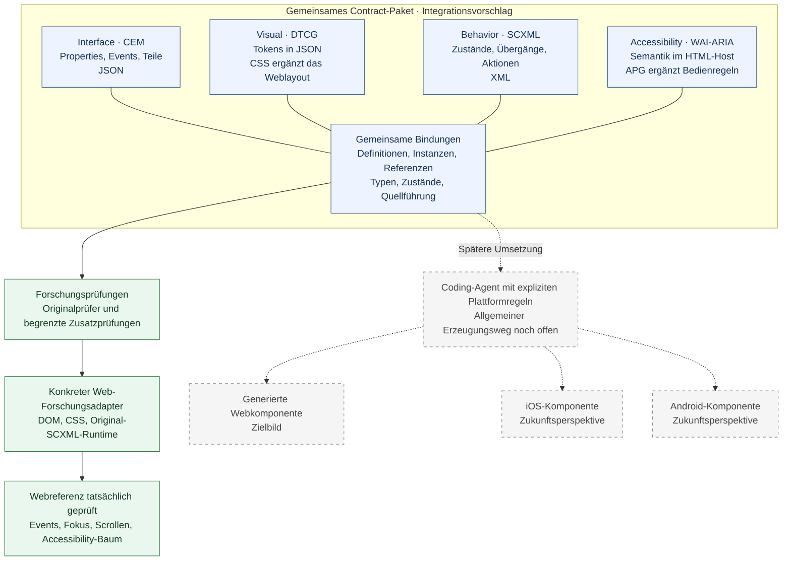

# Archiv der ausführlichen README

**Historische Momentaufnahme vom 25. Oktober 2026, vor der redaktionellen Neuordnung.** Der folgende Text ist inhaltlich vollständig erhalten; relative Verweise wurden an dieses Verzeichnis angepasst. Frühere Zwischenzahlen und Aussagen über damals noch nicht ausgeführte Prüfungen beschreiben ihre jeweilige Forschungsphase. Maßgeblich sind die [heutige README](../../README.md), der [Rechercheabschluss](RESEARCH-CLOSEOUT.md) und der [aktuelle Status](CURRENT-STATUS.md).

---

# UI Contracts

**Aktueller Stand,25. Oktober2026:** 16/16 Erstdurchgänge abgeschlossen;2 offene Nachweise (2 Integration,0 weitere),702 Bedingungen/106 Gruppen. Ein konkreter gemeinsamer Webreferenzlauf ist begrenzt belegt; universelle/native/AT-Integration bleibt unbelegt. [Zwei fehlende Originalklärungen](REMAINING-2.md), [aktive Aufgaben](../../TASKS.md), [historische Fortschrittsnotizen](README-PROGRESS-HISTORY.md).

**Gemeinsamer Vorschlag:** [Integrationsprofil IP-01](INTEGRATION-PROFILE.md) führt die bisherigen Ergebnisse zusammen; ein [gemeinsamer Browserprüfblock](experiments/2026-10-25/ip01-browser/REPORT.md) ist mit 20 erfüllten Erwartungen abgeschlossen. Die gesamte IP-Abnahme und Übertragung auf native Ziele bleiben offen. [Projektlücken und nächste Arbeit](PROJECT-GAPS.md).

UI Contracts untersucht, wie sich **UI-Komponenten maschinenlesbar und technologieunabhängig beschreiben** lassen, damit Menschen und Agenten dieselben eindeutigen Informationen über Schnittstelle, Gestaltung, Verhalten und Accessibility verwenden können.

Das erste Ziel ist ein **gemeinsames Contract-Paket aus bestehenden Beschreibungsansätzen**. Wir untersuchen, welche Anforderungen vorhandene Standards und Projekte abdecken, wo sie sich überschneiden und welche Verbindungen oder Ergänzungen fehlen. Die Auswahl bestimmter Renderer steht noch nicht im Vordergrund.

**Ursprünglicher Projektstart: 23. Oktober 2026. Rechercheabschluss: 25. Oktober 2026.** Dieses Repository enthält die Forschungsgrundlage, konkrete Referenzartefakte und einen geprüften eigenen Webforschungs-Host. Eine produktive Komponentenbibliothek ist noch nicht umgesetzt. iOS/Android sind spätere Perspektiven und keine Voraussetzung dieses Rechercheabschlusses.

**Recherche-/Testrunde abgeschlossen:** [Gemeinsamer Browserlauf](experiments/2026-10-25/ip01-browser/REPORT.md) mit tatsächlichen Events, Fokus, Scrollmessung und Accessibility-Bäumen. [Einordnung des Ziels Web/iOS/Android](ARCHITECTURE-DIRECTION.md). Kein beschlossenes Produktformat und keine allgemeine Plattformfreigabe.

## Einstieg

- [Rechercheabschluss und empfohlene Lesereihenfolge](RESEARCH-CLOSEOUT.md)
- [Gemeinsamer Integrationsvorschlag IP-01](INTEGRATION-PROFILE.md)
- [Tatsächlich geprüfter Browserlauf](experiments/2026-10-25/ip01-browser/REPORT.md)
- [Übergabe für die spätere Umsetzung](IMPLEMENTATION-HANDOFF.md)
- [Alle Dokumente](DOCUMENT-INDEX.md) und [alle 106 Prüfgruppen](experiments/INDEX.md)
- [Matrix](MATRIX.md), [begründete Befunde](CLAIMS.md) und [Quellen](SOURCES.md)
- [Aktueller Status](CURRENT-STATUS.md) und [Aufgaben](../../TASKS.md)

## Wie die Beiträge zusammenwirken

Die vier Domänen behalten ihre Originalformate. Gemeinsame Bindungen verbinden dieselben Definitionen, Instanzen und Teile; die führende Fachinformation bleibt in ihrer jeweiligen Quelle. Das Diagramm zeigt den Forschungsstand und den späteren Erzeugungsweg getrennt.

**Blau:** gemeinsamer Integrationsvorschlag. **Grün:** im begrenzten Forschungsfall ausgeführt. **Gestrichelt:** späterer Erzeugungsweg. Der grüne Webreferenzlauf verwendet einen eigenen konkreten Adapter; er belegt noch keinen allgemeinen Generator oder deklarativen Runtime-Resolver. iOS und Android gehören nicht zur abgeschlossenen aktuellen Recherche.

[Details zu Bindungen und Zuständigkeiten](INTEGRATION-PROFILE.md) · [Nachweise und Grenzen des Browserlaufs](experiments/2026-10-25/ip01-browser/REPORT.md)

## Was wir erreichen wollen

Eine Beschreibung soll präzise genug sein, dass Agenten die fachlichen Regeln nicht aus Screenshots, Quellcode oder schwammigem Freitext erraten müssen. Dazu gehören typisierte Properties und Ereignisse, formale visuelle Regeln, Tokens, Varianten, Themes, Zustände, Bedingungen, Aktionen, Fokus und zugängliche Rückmeldungen.

Bestehende Fachmodelle sollen nach Möglichkeit erhalten und mit ihren eigenen Schemata beziehungsweise Werkzeugen geprüft werden. Ein neuer Integrationsvertrag ist zulässig, wenn er nachgewiesene Lücken schließt; er soll vorhandene Modelle nicht unnötig nachbauen. Damit wollen wir zusätzliche Pflege und spätere Umbauten beim Fortschritt der Substandards begrenzen.

Eine Beispielkomponente veranschaulicht die Anforderungen. Sie ist weder das Produkt dieses Projekts noch der Maßstab, auf den alle anderen Komponenten reduziert werden. Im ursprünglichen Gespräch diente ein Autocomplete dazu, relative Geometrie, begrenzte Listen, Navigation und dynamische Rückmeldungen zu erklären. Acht Pixel Abstand oder fünf sichtbare Einträge sind **Beispielwerte**, keine allgemeinen Produktpflichten.

## Vier getrennte Domänen

| Domäne | Führende Informationen | Verbindung zu den anderen Domänen |
| --- | --- | --- |
| Technische Schnittstelle | Öffentliche Inputs/Properties, Typen, Outputs, Ereignisse und Payloads; benannte Teile | Verhalten löst fachliche Aktionen aus; die öffentliche Signatur wird hier festgelegt |
| Visuelles Design | Typisierte Werte, Tokens, Layoutbeziehungen, Größen, Overflow, Varianten, Themes | Visualisiert referenzierte Zustände; definiert deren Eintritt nicht unabhängig neu |
| UX-Verhalten | Zustände, Ereignisse, Übergänge, Guards, Aktionen und Interaktionsregeln | Bindet Eingaben und Zustandsänderungen an referenzierte Teile und öffentliche Ereignisse |
| Accessibility | Semantik, zugängliche Namen/Beziehungen, Fokus-/Bedienanforderungen und Rückmeldungen | Stellt Anforderungen an Verhalten und Darstellung; Produktvarianten bleiben ausdrücklich gewählt |

**Vier getrennte Dateien sind bevorzugt.** So können eigene Formate, Verantwortlichkeiten und Validatoren erhalten bleiben. Dateinamen und Serialisierungen sind noch nicht festgelegt. JSON und YAML sind Möglichkeiten, keine abgeschlossene Formatentscheidung. Ein Wechsel zwischen beiden macht unterschiedliche Fachschemata nicht automatisch kompatibel.

Strikte Trennung betrifft Verantwortung, nicht Beziehungslosigkeit: Beispielsweise bestimmt Behavior den Auslöser einer Aktualisierung, Accessibility ihre zugängliche Vermittlung und Visual die sichtbare Darstellung. Dieselbe Information soll genau eine führende Quelle besitzen.

## Referenzen und wiederverwendbare Komponenten

Das Paket soll untersuchen, wie getrennt beschriebene Elemente eindeutig zusammengehören: etwa ein Input und sein Overlay, über alle vier Domänen hinweg. Stabile IDs, Namespaces oder URNs sind mögliche Mittel; **URN ist noch keine beschlossene Technik**.

Auch Komposition ist eine Anforderung: Ein Overlay soll eine eigenständig definierte ScrollArea aus derselben Bibliothek verwenden können, statt deren Beschreibung zu duplizieren. Dafür müssen Definition und Instanz, Parameter, Ereignisbindungen, Versionen und Zuständigkeiten für Fokus/Scrollen auseinandergehalten werden.

Vorhandene Modelle bieten bereits unterschiedliche Ansätze: UXSpec dokumentiert Elementreferenzen, Ark ID-Komposition und OpenPencil ID-Bindungen. Das ist ein begründeter Ausgangspunkt, aber kein Nachweis, dass sie gemeinsam dieses Paketmodell erfüllen. Insbesondere externe Versionsbindung, Referenzprüfung und Mehrfachinstanzen bleiben zu validieren. Siehe [C19–C21, C27, C30 und C35](CLAIMS.md).

## Welche Kandidaten wir untersuchen

Die Kandidaten übernehmen unterschiedliche Rollen; sie sind keine austauschbaren Komplettlösungen.

| Rolle | Kandidaten |
| --- | --- |
| Interfacebeschreibung | Custom Elements Manifest; OpenUI Specification unter `openuispec.org` |
| Visuelles Design und Tokens | Google `google-labs-code/design.md`; AgentsORG/DESIGN; DTCG Format und Resolver; Panda CSS |
| Verhalten und Zustandsmodelle | UXSpec von John Lindquist; SCXML; XState; Zag |
| Komponenten-/Designintegration | Ark UI; uSpec von redongreen; OpenPencil Behaviours |
| Accessibility | WAI-ARIA und, getrennt davon, WAI-ARIA APG |
| Ergänzender Layoutvergleich | Vorhandene deklarative Layoutmodelle, zunächst CSS Anchor Positioning und Overflow; weitere Recherche offen |

Eindeutige Links und Stände stehen im [Quellenregister](SOURCES.md). OpenSpec und Requirements as Code sind Gesprächskontext; ihre genaue Projektidentität ist noch ungeklärt. Sie erhalten hier keine erfundenen Fähigkeiten.

## Wie wir Eignung beurteilen

Die Matrix fragt pro konkreter Anforderung: Was deckt der Kandidat ab, in welcher Rolle, mit welcher Begründung und welcher Grenze? Sie unterscheidet **direkte Unterstützung, Unterstützung über Referenz, erforderlichen Adapter, im geprüften Umfang fehlende Abdeckung und ungeprüfte Abdeckung**.

Jede substanzielle Bewertung verweist auf einen Befund und eine Primärquelle. Dokumentationsaussage, manuelle Schema-/Quelltextprüfung und ausgeführter Versuch sind unterschiedliche Evidenzstufen. In dieser ersten Untersuchung wurden Dokumentation und einzelne Definitionen gelesen, **keine Kandidatencompiler, Validatoren oder Laufzeittests ausgeführt**. Fehlender Nachweis wird nicht als negative Eigenschaft ausgegeben. Es gibt keine unbegründeten Gesamtpunkte.

Erste belegte Teilbefunde:

- OpenUI draft-01 beschreibt einfache Props konkret; Zustands-/Lifecycle-Modellierung steht dort noch unter zukünftigen Erweiterungen. Strukturierte öffentliche Event-Payloads sind durch die gelesene Formatspezifikation nicht bestätigt. [C04–C06](CLAIMS.md)
- Google DESIGN.md beschreibt strukturierte Designwerte und benannte Stylevarianten. Der geprüfte Kern liefert noch keine standardisierte Semantik für relative Ankergeometrie. [C07–C10](CLAIMS.md)
- Das gelesene UXSpec-Schema verlangt `$visual` nicht. Verhalten ohne Visual ist damit auf Schemaebene nicht ausgeschlossen; Compiler- und Laufzeitverträglichkeit bleibt offen. [C17](CLAIMS.md)
- DTCG Format und Resolver haben unterschiedliche Aufgaben: Tokenwerte einerseits, Kontext-/Themeauflösung andererseits. [C14–C15](CLAIMS.md)
- WAI-ARIA beschreibt Web-Semantik; APG liefert Interaktionsmuster. Daraus entsteht nicht automatisch ein ausführbarer, plattformneutraler Accessibility-Vertrag. [C31–C32](CLAIMS.md)

## Ownership und Konflikte

Zu untersuchen sind eindeutige Quellen für jede Information sowie explizite Abbildungen zwischen Zuständen, Varianten, Teilen und öffentlichen Ereignissen. Unterschiedliche Fachbegriffe dürfen nicht durch identische Strings scheinbar gleichgesetzt werden.

Beispiele für Konflikte: doppelte Tokenwerte, abweichende Tastaturregeln, falsche Ereignis-Payloads, nicht existierende Teile und kollidierende IDs mehrerer Instanzen. Eigene Domänenvalidatoren und eine mögliche zusätzliche Paketprüfung haben verschiedene Aufgaben. Ein Agent soll solche Widersprüche nicht stillschweigend selbst entscheiden müssen.

Ein gemeinsames Manifest, Resolver und Validator wurden als mögliche Integrationsschicht besprochen, sind aber nicht implementiert oder endgültig ausgewählt. Erst die Einzelmodelle und ihre Referenzen prüfen, dann zusätzliche Regeln definieren.

## Langfristiges Nutzungsziel und spezialisierte Skills

**Festgehalten am 24. Oktober 2026:** UI Contracts soll später produktiv genutzt werden. Darauf sollen spezialisierte Skills für technische Schnittstelle, visuelles Design, UX-Verhalten und Accessibility aufbauen. Jeder Skill soll einen klaren Verantwortungsbereich erhalten und die vereinbarten Referenzen sowie Ownership-Regeln respektieren. Ob diese Einheiten „Domänen“ oder „Bereiche“ heißen, bleibt offen.

Für die spätere Auswahl sind Stabilität und Marktreife notwendig; die konkrete Mindestanforderung ist noch zu operationalisieren. Weder die Benennung eines Kandidaten noch ein vorhandenes Schema belegt produktive Eignung. Spezifikation und Werkzeuge müssen jeweils nach Version, Reifegrad und Kompatibilitätszusagen beurteilt werden.

**Aktueller Umfang:** Dieses Ziel wird dokumentiert. Es werden keine Skills erstellt, keine Technologien als ausgewählt erklärt und keine Implementierung begonnen. Die nächste begrenzte Vergleichsaufgabe steht in der Forschungsplanung.

## Weiterarbeit mit einem Coding-Agenten

Zuerst Anforderungen, Methode und offene Zellen lesen; historische Chatbehauptungen nicht als technische Fakten übernehmen. Anschließend konkrete Quellenstände pinnen und kleine positive sowie negative Contract-Prüffälle erstellen. Gemeinsame Referenzen und die Wiederverwendung einer Unterkomponente ausdrücklich prüfen.

Die im Original bestätigten Detailvergleiche sind dokumentarisch ausgearbeitet, mit eigenen ungetesteten Prüffällen und offengelegten Grenzen:

1. [DESIGN.md gegen bestehende deklarative Layoutmodelle](COMPARE-DESIGN-LAYOUT.md) – formale Werte, Geometrie, Begrenzung und Overflow.
2. [UXSpec gegen SCXML](COMPARE-UXSPEC-SCXML.md) – isoliertes Verhalten, Semantik und eigenständige Validierung.

Diese Vergleiche sind Teil der anforderungsorientierten Untersuchung, keine Vorentscheidung für bestimmte Formate. Die spätere Plattformübertragung kann etwa Swift/SwiftUI, TypeScript, Angular, React und weitere Systeme betreffen. Ein erfolgreiches Web-Beispiel beweist keine native Kompatibilität. Zunächst steht das konsistente Contract-Paket im Vordergrund.

## Herkunft und Korrektur der ersten Dokumentation

Grundlage ist das vollständig als Text gelesene [Gespräch „Open Design erklären“](https://chatgpt.com/share/6adba3c9-accc-83ed-adbf-a78f5a880760) mit 71 Nachrichten und 36 Nutzerbeiträgen sowie nachfolgende Präzisierungen. [REQUIREMENTS.md](REQUIREMENTS.md) trennt unmittelbare Nutzeranforderungen, bestätigte Vorschläge und spätere Ergänzungen.

Die erste README entstand aus einem begrenzten Gesprächsausschnitt. Nach dem Vollabgleich wurden zwei Zuordnungen korrigiert: OpenUI meint `openuispec.org`, nicht `open-ui.org`; Google DESIGN.md meint das eigene `design.md`-Projekt, nicht nur Stitch Skills. UXSpec ist eindeutig identifiziert. Die Beispielkomponente wird nun dem allgemeinen Forschungsziel untergeordnet.

**Arbeitsstand:** Informationssammlung und erste qualitative Abdeckungsuntersuchung. Keine Komponente implementiert, kein universelles Format festgelegt, keine vollständige Standardkonformität behauptet.

## Gesamtprüfung der verbliebenen Felder

Alle 72 Ausgangszellen sind im [Einzelprotokoll](ALL-FIELDS-REVIEW.md) dokumentarisch erneut ausgewertet. Fünf konnten begründet eingeordnet werden; **67 technische Nachweise bleiben offen (41 Integration, 26 weitere)**. Neue Befunde betreffen Instanzkomposition, OpenPencil-Libraryrevisionen, CSS-Modusauswahl sowie Grenzen der UXSpec-Vorschau und des Originalschemas. Die Prüfung wurde nicht mit einer abgeschlossenen technischen Integration verwechselt. Keine E3-Versuche, keine Implementierung, kein Commit oder Push in diesem Paket.

## Erste tatsächlich ausgeführte Forschungsnachweise

Nach der dokumentarischen Gesamtprüfung wurden [49 begrenzte Proben](experiments/2026-10-24/REPORT.md) ausgeführt. CEM I02 ist für TypeScript-Typtexte plus explizite CustomEvent.detail-Projektion nun A; **aktuell verbleiben 65 U-Nachweise (41 Integration, 24 weitere)**. Das CEM-Gesamtschema lässt einen numerischen Eventnamen durch; UXSpecs vollständiger machineInvoke-Eintrag scheitert an oneOf, ein unvollständiger passiert. Der geprüfte Nu-Checker erkennt nicht alle Referenzfehler. Eingaben, Ausgaben, Werkzeugstände und unerwartete Ergebnisse sind gespeichert. Keine Komponente oder vollständige Integration implementiert, kein Commit oder Push. Frühere Aussagen ohne E3 gelten als historischer Stand.

Zusätzlich ist [SCXML I02 als Adapterbeitrag](experiments/2026-10-24/scxml/REPORT.md) eingeordnet: öffentliche CEM-Signatur bleibt getrennt, statische send/param-Bindung ist geprüft. Die Original-XSD-Kombination akzeptiert einen fehlenden Zielzustand; dies bleibt als unerwartetes Ergebnis dokumentiert. Aktueller Reststand: 65 U.

**Referenz-Folgearbeit:** [14 explorative Prüfungen](experiments/2026-10-24/references/REPORT.md) sind übernommen; jetzt insgesamt 63 Prüffälle, weiterhin 65 U. Neue konkrete Grenzen: stille Modulüberschreibung bei schema-konformen Maschinen-ID-Kollisionen, Einheitenverlust und Widerspruch zwischen Referenzschema und Compilerpfad. Keine UI-Komponente implementiert, kein Commit/Push.

**CSS-Folgearbeit:** [Zwei gebundene Grammatikprüfer](experiments/2026-10-24/css-grammar/REPORT.md) sind mit 34 Fall-/Versionspaaren übernommen. Insgesamt 97 benannte Prüfbedingungen, weiterhin 65 U. Vorhandene Teilunterstützung wird nicht mit vollständiger Draftkonformität gleichgesetzt. Kein Commit oder Push.

**Originalvalidator-Folgeprüfung:** [OpenPencil: 31 Fälle](experiments/2026-10-24/openpencil-validation/REPORT.md) trennen Variablendaten, sichere CSS-Ausgabe und fachliche Konformität. 30 von 31 vorher gespeicherten Erwartungen bestätigt; eine unerwartete Arrayannahme bleibt offen dokumentiert. Weiterhin 63 U.

**Layoutfolgeprüfung:** [OpenPencils ursprüngliche Layoutfelder und Webprojektion](experiments/2026-10-24/openpencil-layout/REPORT.md) belegen V05 als A; Positionierungs-/Scrollfragen bleiben differenziert offen. Aktuell 62 U.

**25.10.2026:** [Konkreter Switch-Accessibility-Bezug](experiments/2026-10-25/openpencil-a11y/REPORT.md) dokumentiert; A02 nun R. Keine zusätzliche E3-Probe gezählt. 61 offene Nachweise, weiterhin kein Commit/Push.

**Historischer Teilabschluss vor SCXML-Laufzeit und DTCG:** [Getrennte Originalsprachen und zwei Instanzen](experiments/2026-10-25/four-domain/REPORT.md) mit Originalprüfungen, statischen Gegenfällen und Browsergeometrie nachgewiesen. X01 bei vier Beiträgen U→A; insgesamt 57 offene Nachweise. 217 Bedingungen, keine vollständige interaktive Integration oder Produktformatwahl. Kein Commit oder Push.

[Verbindlicher aktueller Nachweisstand und Abnahme dieses Pakets](CURRENT-STATUS.md).

[Alle ausgeführten Nachweisgruppen mit Outputs und Prüfgrenzen](experiments/INDEX.md).
