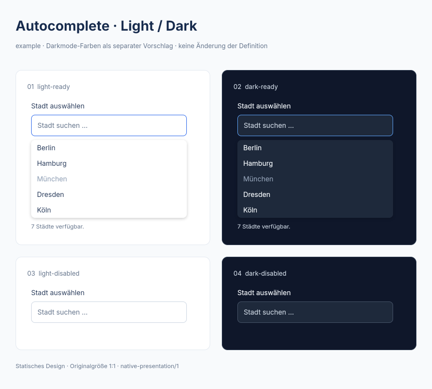

# Autocomplete · Light-/Darkmode-Präsentationstest

Separater visueller Vorschlag auf Basis der example-Bibliothek und des unveränderten run-04-Builder-A-Artefakts. `ready` und `disabled` werden jeweils nebeneinander in Light und Dark gezeigt. Die aktuelle example-Bibliothek hat keine normative Darkmode-Definition; die Farben in [theme-proposal.json](theme-proposal.json) sind deshalb ausdrücklich ein neuer Demonstrationsvorschlag, keine nachträgliche Forschungsbewertung.

[Editierbare FIG](autocomplete.fig) · [Readback und Hashes](preview-check.json) · [Generator](../../../../../tools/openpencil/theme-example.mjs).

Der Generator klont die beiden vorhandenen Zustandsgruppen. Die Darkmode-Kandidaten erhalten die separat protokollierten Farbänderungen. Anschließend platziert das gemeinsame Layout beide Modi auf ihrem angegebenen Kartenhintergrund. Die Präsentation darf die so vorbereiteten Kandidaten nicht verändern; dies wird vor Export sowie nach erneutem FIG-Einlesen und PNG-Rendering geprüft. Die äußere Übersichtsseite bleibt neutral.

Zum Nachvollziehen den Generator lesen; eine erneute Ausführung benötigt einen neuen Ergebnisstand. Er überschreibt weder diese Ausgaben noch die ursprüngliche FIG oder die example-Definition. Die gespeicherte PNG ist ein Rendering der nativen FIG, kein Screenshot eines geöffneten Editors. Keine neue Runtime-/ARIA-, Kontrast- oder Live-GUI-Abnahme.
